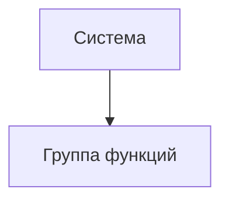

# Документ о концепции и границах кейса

**Система:** интеграция ERP «СтройБаза-4.2» с API ТК «ГрузВектор v2»  
**Организация:** ООО «РемКвартал-Ритейл»  
**Источники:** служебная записка финдиректора (Док. 1.1), расшифровка совещания (Док. 1.2), выгрузка ServiceDesk (Док. 1.3), описание ERP (Блок 2), документация API «ГрузВектор v2» (Блок 3)  
**Назначение:** концепция и границы проекта автоматизации логистического контура

| Поле | Значение |
|------|----------|
| Кейс | 07 - Склад |
| Индустриальный партнер | ООО «РемКвартал-Ритейл» |
| Версия | `0.1-draft` |
| Дата | 2026-10-21 |
| Статус | черновик |
| Авторы | Зотьев А.Р ; Фесенко Д.А. ; Кузнецов И.Н. |

## 1. Введение

ООО «РемКвартал-Ритейл» - федеральная сеть DIY-гипермаркетов с интернет-магазином и самописной ERP «СтройБаза-4.2» (PostgreSQL 11, доступ только через внутренний REST-шлюз, см. Блок 2). Сейчас доставка крупногабаритных заказов работает на ручном приводе. Проблемы делятся на два класса.

**Прямые убытки от расчёта** Сайт считает стоимость доставки по физическому весу, транспортная компания «ГрузВектор» тарифицирует по объёмному - разница уходит в убыток, по данным финансового директора до 3,8 млн ₽/мес (Док. 1.1). Усугубляет ситуацию то, что у 30% старых позиций в ERP не заполнены габариты (Блок 2), поэтому объёмный вес по ним не посчитать.

**Косвенные убытки от ручных процессов** Операторы вручную вбивают накладные в личный кабинет ТК, ошибаются в адресах и телефонах (Док. 1.1). Логисты раз в сутки пересылают трек-номера через Excel (Док. 1.2). Этикетки печатаются на офисном А4 и не читаются сканерами курьеров (Док. 1.2). 60% звонков в контакт-центр - «Где мой заказ?». Бухгалтерия не может автоматически списать товар и признать выручку из-за опечаток в номерах заказов (Док. 1.1).

Проект - это интеграционный слой между ERP и API «ГрузВектор v2», который закрывает три разрыва. Первый - расчёт: стоимость доставки считается по ВГХ и объёмному весу до оплаты, а не постфактум по счёту ТК. Второй - регистрация и печать: ERP сама создаёт отправление в ТК, получает трек-номер и `label_url`, а кладовщик печатает этикетку на Zebra в момент последнего сканирования на ТСД. Третий - статусы: webhook от ТК обновляет заказ в ERP автоматически, без Excel и ручной сверки. Статус `CANCELLED` в MVP покрывает два случая. Отмена клиентом: если метод отмены доступен в API ТК, до `COURIER_ASSIGNED` она проходит автоматически, после - только через старшего логиста ТК. Если метода в API нет, система блокирует автоматическое действие и передаёт задачу оператору (Транскрибация). Неудачная доставка: при получении webhook `DELIVERY_FAILED` заказ напрямую переводится в статус `CANCELLED` с указанием причины в `cancel_reason`. Автоматический возврат товара и денег на первом этапе не реализуется.

## 2. Бизнес-контекст и цели

### 2.1. Исходные данные

Сейчас доставка в «РемКвартале» держится на ручных переходах, и каждый даёт свою утечку.

**Прямые убытки от расчёта.** Сайт считает доставку по физическому весу, а ТК тарифицирует по объёмному. Разница уходит в убыток — по данным финансового директора, кассовый разрыв составляет 3,8 млн ₽/мес (Док. 1.1). Усугубляет проблему то, что у 30% старых позиций в ERP не заполнены габариты (Блок 2).

**Косвенные убытки от ручных процессов.** Операторы вручную вбивают накладные в личный кабинет ТК, логисты пересылают трек-номера через Excel раз в сутки, а этикетки печатаются на офисном А4 и не читаются сканерами (Док. 1.2). Из-за этого 60% звонков в контакт-центр — это «Где мой заказ?» (Док. 1.2). Отдельная проблема — несинхронизированная отмена: клиент отменяет заказ на сайте и получает возврат денег, но склад уже мог отгрузить товар в ТК. В итоге компания оплачивает холостой пробег и возврат груза (Док. 1.2, Транскрибация).

**Репутационные риски.** Возвраты не отражаются в ERP, деньги клиентам автоматически не возвращаются. Это создает юридические риски (Роспотребнадзор) и подрывает доверие к магазину (Док. 1.3, тикет #4590).

### 2.2. Возможности бизнеса

Закрытие выявленных в MVP разрывов даёт компании следующие возможности:

*   **Устранение прямых финансовых потерь.** Переход на расчёт по объёмному весу до оплаты заказа позволяет выровнять стоимость доставки на сайте с тарифами перевозчика. Компания перестаёт терять до 3,8 млн ₽/мес на кассовых разрывах (Док. 1.1).

*   **Снижение операционных издержек и ошибок ручного ввода.** Автоматическая передача данных из ERP в ТК исключает ручное заполнение накладных в личном кабинете. Печать этикеток сразу на термопринтере (Zebra) вместо бумаги А4 и скотча решает проблему нечитаемых штрихкодов и потери времени кладовщика (Док. 1.2).

*   **Разгрузка клиентского сервиса.** Автоматическое обновление статусов доставки через webhook позволяет клиентам видеть реальную картину в личном кабинете. Это снижает долю звонков «Где мой заказ?» (сейчас 60% входящей линии) и исключает необходимость вручную пересылать Excel-файлы с треками (Док. 1.2).

*   **Контроль над отменами заказов.** Интеграция со статусами ТК позволяет системе блокировать отмену заказа на сайте, если он уже передан перевозчику (находится в пути или у курьера). Это предотвращает холостые пробеги и оплату возврата груза (Док. 1.2, Транскрибация). При отсутствии метода отмены в API система переведёт этот процесс в ручную эскалацию оператору.

*   **Прозрачность данных для бухгалтерии.** Сквозная связь «заказ — отправление — счёт» позволяет автоматически списывать товар и признавать выручку, избавляя бухгалтерию от ручных сверок и ошибок сопоставления номеров заказов и трек-кодов (Док. 1.1).

### 2.3. Бизнес-цели

| ID | Цель | Масштаб | Способ измерения | База | План | Обязательный порог | Срок |
|----|------|---------|------------------|------|------|--------------------|------|
| BO-1 | Снизить убытки от расхождения расчётной и фактической стоимости доставки | Кассовый разрыв по направлению логистики | Сверка счетов от ТК и расчетов на сайте | 3,8 млн ₽/мес | уточнить (согласовать с финдиректором) | уточнить | 2 месяца |
| BO-2 | Исключить ручной ввод накладных и трек-номеров | Доля заказов, оформляемых через ЛК ТК и Excel | Анализ логов системы (количество API-запросов) | 100% заказов | Не менее 90% заказов | Не менее 90% | С запуска MVP |
| BO-3 | Разгрузить контакт-центр от запросов «Где мой заказ?» | Доля входящей линии КЦ | Статистика обращений в КЦ | 60% звонков | уточнить | уточнить | 1–2 месяца после запуска |
| BO-4 | Сократить время от сборки заказа до появления трек-номера в ERP | Время между завершением сборки и получением трека | Таймстемпы в ERP (события статусов) | До 24 часов | Минуты | уточнить | С запуска MVP |
| BO-5 | Исключить убытки от отмены заказов, переданных в ТК | Доля автоматических отмен после `COURIER_ASSIGNED` | Логи системы, отчеты по холостым пробегам | Есть прецеденты | 0% | 0% | С запуска MVP |

### 2.4. Видение решения

Для сотрудников склада, контакт-центра и финансового департамента «РемКвартал-Ритейл», которым необходимо прекратить утечку денег и убрать ручной труд, интеграционный слой между ERP «СтройБаза-4.2» и API ТК «ГрузВектор» — это программный модуль, который автоматически рассчитывает стоимость по объёмному весу, создаёт отправления и синхронизирует статусы доставки. В отличие от текущего процесса с ручным вводом в ЛК ТК, Excel-файлами и печатью на А4, решение делает связи «заказ — отправление — счёт» сквозными, устраняя убытки от человеческих ошибок и рассинхрона.

## 3. Стейкхолдеры

### 3.1. Профили заинтересованных лиц

| Заинтересованное лицо | Основная ценность | Отношение | Основные интересы | Ограничения |
|-----------------------|-------------------|-----------|-------------------|-------------|
| Генеральный директор | Снижение убытков и повышение эффективности доставки | Положительное при достижении бизнес-целей проекта | Снижение расходов, сохранение возможности доставки по ассортименту, окупаемость проекта | Ограничения бюджета, необходимость обосновать инвестиции и ожидаемый экономический эффект |
| Финансовый директор | Прозрачность и точность учёта расходов на доставку | Положительное при обеспечении контролируемых затрат | Соответствие фактических затрат расчётам, снижение расходов, корректный финансовый учёт | Необходимость подтверждать экономический эффект и согласовывать изменения финансовых процессов |
| Руководитель склада | Ускорение обработки заказов и снижение количества ручных операций | Положительное при упрощении складских операций | Быстрый поиск трек-номера, удобная печать этикеток, сокращение ручного ввода | Отсутствие ВГХ (габаритов) у 30% номенклатуры, разнородность  печатного оборудования и условия влажности на складе |
| Руководитель службы клиентского сервиса | Повышение качества информирования покупателей | Положительное при увеличении актуальности данных | Актуальные статусы доставки, сокращение обращений, корректная обработка отмен и возвратов | Необходимость сохранить качество обслуживания во время внедрения, зависимость от ручной передачи Excel-файлов (раз в сутки) и отсутствие автоматического получения статусов из API ТК на текущий момент |
| Руководитель проекта интеграции логистики | Управляемость проекта и достижение согласованных результатов | Заинтересованное в реализации проекта в установленные сроки | Согласованный объём MVP, соблюдение сроков, устранение противоречий между требованиями | Ограничения бюджета, сроков, ресурсов команды и зависимость от согласований заинтересованных сторон |
| Ведущий разработчик ERP | Надёжность и совместимость интеграционного решения | Положительное при технической реализуемости решения | Сохранение производительности, совместимость с архитектурой ERP, надёжный обмен данными | Ограничения архитектуры ERP, доступ к БД через REST-шлюз, требования к нагрузке и периодичности фоновых задач |
| Ведущий специалист по информационной безопасности | Защита данных и соответствие требованиям ИБ | Положительное при полном соблюдении политик безопасности | Безопасное хранение токенов, отсутствие прямого доступа к БД извне, защита персональных данных клиентов в логах | Запрет на передачу токенов на клиентскую сторону (браузер/ТСД), внешние вызовы только с серверной стороны |
| Старший логист-диспетчер | Сокращение ручной передачи данных об отправлениях | Положительное при снижении трудозатрат | Отказ от ежедневной передачи Excel-файлов с трек-номерами, прозрачность статусов отправлений | Необходимость сохранить контроль над отправлениями и учитывать действующий порядок взаимодействия с ТК |
| ТК «ГрузВектор» | Получение корректно оформленных отправлений | Нейтральное или положительное при соблюдении требований ТК | Корректные заявки, валидные данные отправлений, соблюдение ограничений API | Лимит 5 запросов/сек к API, таймаут 3000 мс для webhooks, правила тарификации (объемный вес, наценка за негабарит >2.2 м), ограничение веса места до 1500 кг и отсечка приема заказов на сегодня в 13:00 |
| Покупатели | Предсказуемая доставка и прозрачность информации о заказе | Положительное при улучшении качества доставки и обслуживания | Соблюдение сроков доставки, актуальные статусы, корректная обработка отмен и возврат денежных средств | Зависимость от доступности доставки по адресу, сроков перевозчика и соблюдения покупателем условий получения заказа |

### 3.2. Матрица влияния / интереса

| Стейкхолдер | Влияние (низкое / среднее / высокое) | Интерес (низкий / средний / высокий) | Стратегия работы |
|-------------|--------------------------------------|--------------------------------------|------------------|
| Генеральный директор | Высокое | Высокий | Согласовывать бизнес-цели, бюджет и критерии успешности проекта; регулярно представлять результаты |
| Финансовый директор | Высокое | Средний | Вовлекать в согласование модели расчёта расходов, показателей экономического эффекта и правил финансового учёта |
| Начальник центрального склада | Среднее | Высокий | Регулярно согласовывать требования к складскому процессу, проверять удобство решения и участвовать в приёмочном тестировании |
| Руководитель службы клиентского сервиса | Высокое | Высокий | Согласовывать требования к статусам доставки, отменам и возвратам; проверять сценарии обслуживания покупателей |
| Руководитель проекта интеграции логистики | Высокое | Высокий | Вовлекать в ежедневное управление проектом, приоритизацию требований, контроль сроков, рисков и зависимостей |
| Ведущий разработчик ERP | Высокое | Высокий | Привлекать к проектированию интеграции, оценке технических ограничений и выбору архитектурных решений |
| Ведущий специалист по информационной безопасности | Высокое | Высокий | Согласовывать архитектуру интеграции (токены, логирование, доступ к данным); проводить проверку безопасности перед релизом |
| Старший логист-диспетчер | Среднее | Высокий | Регулярно собирать обратную связь, согласовывать сценарии работы с отправлениями и проверять корректность обмена данными |
| ТК «ГрузВектор» | Высокое | Средний | Согласовывать технические требования, ограничения API, порядок обработки ошибок и правила взаимодействия при сбоях |
| Покупатели | Низкое | Высокий | Учитывать клиентские сценарии, анализировать обращения и жалобы, проверять корректность информирования о доставке и возвратах |

## 4. Функциональные требования

### 4.1. Основные функции

| ID | Функция | Краткое описание |
|----|---------|------------------|
| FE-1 | | |
| FE-2 | | |

### 4.2. Дерево функций

### 4.3. Пользовательские истории / варианты использования

| Основное действующее лицо | Варианты использования |
|---------------------------|------------------------|
| | |

### 4.4. Детальный сценарий (минимум один)

#### UC-1. _Название_

| Поле | Значение |
|------|----------|
| Автор / дата | |
| Основное действующее лицо | |
| Дополнительные действующие лица | |
| Описание | |
| Условие-триггер | |
| Предварительные условия | PRE-1. |
| Выходные условия | POST-1. |
| Приоритет | высокий / средний / низкий |
| Частота использования | |
| Бизнес-правила | BR-… |

**Нормальное направление**

1.
2.

**Альтернативные направления**

- 1.1 …

**Исключения**

- 1.0.E1 …

**Другая информация**

-

**Предположения**

-

### 4.5. Сжатые сценарии (по образцу Вигерса)

Остальные UC можно описать короче, если ключевая информация уже есть в другом источнике.

#### UC-n. _Название_

- Описание:
- Исключения:
- Приоритет:
- Бизнес-правила:
- Другая информация:

## 5. Нефункциональные требования

| ID | Категория | Требование | Метрика / порог |
|----|-----------|------------|-----------------|
| NFR-P1 | Производительность | | |
| NFR-A1 | Доступность | | |
| NFR-S1 | Безопасность | | |
| NFR-C1 | Совместимость / IT-ландшафт | | |
| NFR-U1 | Удобство использования | | |

## 6. Границы кейса

### 6.1. In Scope

- …

### 6.2. Out of Scope

- …

### 6.3. Состав первого и последующих выпусков

| Функция | Выпуск 1 | Выпуск 2 | Выпуск 3 |
|---------|----------|----------|----------|
| FE-1 | | | |
| FE-2 | | | |

## 7. Ограничения и допущения

### 7.1. Ограничения и исключения

| ID | Формулировка |
|----|--------------|
| LI-1 | |

### 7.2. Предположения и зависимости

| ID | Тип | Формулировка |
|----|-----|--------------|
| AS-1 | допущение | |
| DE-1 | зависимость | |

### 7.3. Приоритеты проекта

| Область | Ограничения | Движущая сила | Степень свободы |
|---------|-------------|---------------|-----------------|
| Функции | | | |
| Качество | | | |
| Сроки | | | |
| Расходы | | | |
| Персонал | | | |

### 7.4. Особенности развертывания

Стек, инфраструктура, обучение пользователей, необходимые изменения смежных систем.

## 8. Риски

| ID | Риск | Вероятность (0–1) | Ущерб (1–10) | Митигация |
|----|------|-------------------|--------------|-----------|
| RI-1 | | | | |

> [!WARNING]
> Риски, которые могут сорвать приемку выпуска 1, вынесите сюда явно.

## 9. Критерии приемки

| ID | Критерий | Как проверяется | Порог | Срок |
|----|----------|-----------------|-------|------|
| SM-1 | | | | |
| AC-1 | | | | |

Партнер принимает работу, если выполнены все критерии со статусом «обязательный» и закрыты In Scope функции выпуска 1.
