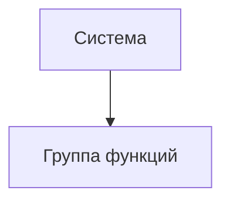

# Документ о концепции и границах кейса

**Система:** интеграция ERP «СтройБаза-4.2» с API ТК «ГрузВектор v2»  
**Организация:** ООО «РемКвартал-Ритейл»  
**Источники:** служебная записка финдиректора (Док. 1.1), расшифровка совещания (Док. 1.2), выгрузка ServiceDesk (Док. 1.3), описание ERP (Блок 2), документация API «ГрузВектор v2» (Блок 3)  
**Назначение:** концепция и границы проекта автоматизации логистического контура

| Поле | Значение |
|------|----------|
| Кейс | 07 - Склад |
| Индустриальный партнер | ООО «РемКвартал-Ритейл» |
| Версия | `0.1-draft` |
| Дата | 2026-10-21 |
| Статус | черновик |
| Авторы | Зотьев А.Р ; Фесенко Д.А. ; Кузнецов И.Н. |

## 1. Введение

ООО «РемКвартал-Ритейл» - федеральная сеть DIY-гипермаркетов с интернет-магазином и самописной ERP «СтройБаза-4.2» (PostgreSQL 11, доступ только через внутренний REST-шлюз, см. Блок 2). Сейчас доставка крупногабаритных заказов работает на ручном приводе. Проблемы делятся на два класса.

**Прямые убытки от расчёта** Сайт считает стоимость доставки по физическому весу, транспортная компания «ГрузВектор» тарифицирует по объёмному - разница уходит в убыток, по данным финансового директора до 3,8 млн ₽/мес (Док. 1.1). Усугубляет ситуацию то, что у 30% старых позиций в ERP не заполнены габариты (Блок 2), поэтому объёмный вес по ним не посчитать.

**Косвенные убытки от ручных процессов** Операторы вручную вбивают накладные в личный кабинет ТК, ошибаются в адресах и телефонах (Док. 1.1). Логисты раз в сутки пересылают трек-номера через Excel (Док. 1.2). Этикетки печатаются на офисном А4 и не читаются сканерами курьеров (Док. 1.2). 60% звонков в контакт-центр - «Где мой заказ?». Бухгалтерия не может автоматически списать товар и признать выручку из-за опечаток в номерах заказов (Док. 1.1).

Проект - это интеграционный слой между ERP и API «ГрузВектор v2», который закрывает три разрыва. Первый - расчёт: стоимость доставки считается по ВГХ и объёмному весу до оплаты, а не постфактум по счёту ТК. Второй - регистрация и печать: ERP сама создаёт отправление в ТК, получает трек-номер и `label_url`, а кладовщик печатает этикетку на Zebra в момент последнего сканирования на ТСД. Третий - статусы: webhook от ТК обновляет заказ в ERP автоматически, без Excel и ручной сверки. Статус `CANCELLED` в MVP покрывает два случая. Отмена клиентом: до `COURIER_ASSIGNED` проходит автоматически, после - только через старшего логиста ТК с проверкой статуса (Док. 1.2). Неудачная доставка: при получении webhook `DELIVERY_FAILED` заказ переводится в `CANCELLED` с указанием причины в `cancel_reason`, запускается возврат товара и денег.

## 2. Бизнес-контекст и цели

### 2.1. Исходные данные

Как процесс устроен сейчас, какие потери времени / денег / качества наблюдаются, на каких фактах это основано.

### 2.2. Возможности бизнеса

Что изменится, если решение появится; какие смежные возможности откроются позже.

### 2.3. Бизнес-цели

| ID | Цель | Масштаб | Способ измерения | База | План | Обязательный порог | Срок |
|----|------|---------|------------------|------|------|--------------------|------|
| BO-1 | | | | | | | |
| BO-2 | | | | | | | |
| BO-3 | | | | | | | |

### 2.4. Видение решения

Одно-два предложения в формате: *для [пользователь], который [потребность], [имя системы] — это [тип продукта], который [ключевые возможности]. В отличие от [альтернатива], решение [отличие]*.

## 3. Стейкхолдеры

### 3.1. Профили заинтересованных лиц

| Заинтересованное лицо | Основная ценность | Отношение | Основные интересы | Ограничения |
|-----------------------|-------------------|-----------|-------------------|-------------|
| | | | | |

### 3.2. Матрица влияния / интереса

| Стейкхолдер | Влияние (низкое / среднее / высокое) | Интерес (низкий / средний / высокий) | Стратегия работы |
|-------------|--------------------------------------|--------------------------------------|------------------|
| | | | |

## 4. Функциональные требования

### 4.1. Основные функции

| ID | Функция | Краткое описание |
|----|---------|------------------|
| FE-1 | | |
| FE-2 | | |

### 4.2. Дерево функций

### 4.3. Пользовательские истории / варианты использования

| Основное действующее лицо | Варианты использования |
|---------------------------|------------------------|
| | |

### 4.4. Детальный сценарий (минимум один)

#### UC-1. _Название_

| Поле | Значение |
|------|----------|
| Автор / дата | |
| Основное действующее лицо | |
| Дополнительные действующие лица | |
| Описание | |
| Условие-триггер | |
| Предварительные условия | PRE-1. |
| Выходные условия | POST-1. |
| Приоритет | высокий / средний / низкий |
| Частота использования | |
| Бизнес-правила | BR-… |

**Нормальное направление**

1.
2.

**Альтернативные направления**

- 1.1 …

**Исключения**

- 1.0.E1 …

**Другая информация**

-

**Предположения**

-

### 4.5. Сжатые сценарии (по образцу Вигерса)

Остальные UC можно описать короче, если ключевая информация уже есть в другом источнике.

#### UC-n. _Название_

- Описание:
- Исключения:
- Приоритет:
- Бизнес-правила:
- Другая информация:

## 5. Нефункциональные требования

| ID | Категория | Требование | Метрика / порог |
|----|-----------|------------|-----------------|
| NFR-P1 | Производительность | | |
| NFR-A1 | Доступность | | |
| NFR-S1 | Безопасность | | |
| NFR-C1 | Совместимость / IT-ландшафт | | |
| NFR-U1 | Удобство использования | | |

## 6. Границы кейса

### 6.1. In Scope

- …

### 6.2. Out of Scope

- …

### 6.3. Состав первого и последующих выпусков

| Функция | Выпуск 1 | Выпуск 2 | Выпуск 3 |
|---------|----------|----------|----------|
| FE-1 | | | |
| FE-2 | | | |

## 7. Ограничения и допущения

### 7.1. Ограничения и исключения

| ID | Формулировка |
|----|--------------|
| LI-1 | |

### 7.2. Предположения и зависимости

| ID | Тип | Формулировка |
|----|-----|--------------|
| AS-1 | допущение | |
| DE-1 | зависимость | |

### 7.3. Приоритеты проекта

| Область | Ограничения | Движущая сила | Степень свободы |
|---------|-------------|---------------|-----------------|
| Функции | | | |
| Качество | | | |
| Сроки | | | |
| Расходы | | | |
| Персонал | | | |

### 7.4. Особенности развертывания

Стек, инфраструктура, обучение пользователей, необходимые изменения смежных систем.

## 8. Риски

| ID | Риск | Вероятность (0–1) | Ущерб (1–10) | Митигация |
|----|------|-------------------|--------------|-----------|
| RI-1 | | | | |

> [!WARNING]
> Риски, которые могут сорвать приемку выпуска 1, вынесите сюда явно.

## 9. Критерии приемки

| ID | Критерий | Как проверяется | Порог | Срок |
|----|----------|-----------------|-------|------|
| SM-1 | | | | |
| AC-1 | | | | |

Партнер принимает работу, если выполнены все критерии со статусом «обязательный» и закрыты In Scope функции выпуска 1.
