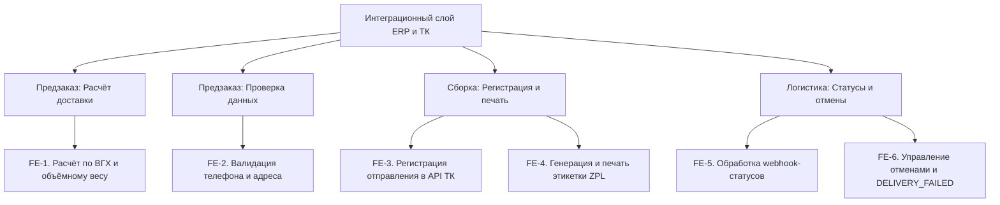

# Документ о концепции и границах кейса

**Система:** интеграция ERP «СтройБаза-4.2» с API ТК «ГрузВектор v2»  
**Организация:** ООО «РемКвартал-Ритейл»  
**Источники:** служебная записка финдиректора (Док. 1.1), расшифровка совещания (Док. 1.2), выгрузка ServiceDesk (Док. 1.3), описание ERP (Блок 2), документация API «ГрузВектор v2» (Блок 3)  
**Назначение:** концепция и границы проекта автоматизации логистического контура

| Поле | Значение |
|------|----------|
| Кейс | 07 - Склад |
| Индустриальный партнер | ООО «РемКвартал-Ритейл» |
| Версия | `0.1-draft` |
| Дата | 2026-10-21 |
| Статус | черновик |
| Авторы | Зотьев А.Р ; Фесенко Д.А. ; Кузнецов И.Н. |

## 1. Введение

ООО «РемКвартал-Ритейл» - федеральная сеть DIY-гипермаркетов с интернет-магазином и самописной ERP «СтройБаза-4.2» (PostgreSQL 11, доступ только через внутренний REST-шлюз, см. Блок 2). Сейчас доставка крупногабаритных заказов работает на ручном приводе. Проблемы делятся на два класса.

**Прямые убытки от расчёта** Сайт считает стоимость доставки по физическому весу, транспортная компания «ГрузВектор» тарифицирует по объёмному - разница уходит в убыток, по данным финансового директора до 3,8 млн ₽/мес (Док. 1.1). Усугубляет ситуацию то, что у 30% старых позиций в ERP не заполнены габариты (Блок 2), поэтому объёмный вес по ним не посчитать.

**Косвенные убытки от ручных процессов** Операторы вручную вбивают накладные в личный кабинет ТК, ошибаются в адресах и телефонах (Док. 1.1). Логисты раз в сутки пересылают трек-номера через Excel (Док. 1.2). Этикетки печатаются на офисном А4 и не читаются сканерами курьеров (Док. 1.2). 60% звонков в контакт-центр - «Где мой заказ?». Бухгалтерия не может автоматически списать товар и признать выручку из-за опечаток в номерах заказов (Док. 1.1).

Проект - это интеграционный слой между ERP и API «ГрузВектор v2», который закрывает три разрыва. Первый - расчёт: стоимость доставки считается по ВГХ и объёмному весу до оплаты, а не постфактум по счёту ТК. Второй - регистрация и печать: ERP сама создаёт отправление в ТК, получает трек-номер и `label_url`, а кладовщик печатает этикетку на Zebra в момент последнего сканирования на ТСД. Третий - статусы: webhook от ТК обновляет заказ в ERP автоматически, без Excel и ручной сверки. Статус `CANCELLED` в MVP покрывает два случая. Отмена клиентом: если метод отмены доступен в API ТК, до `COURIER_ASSIGNED` она проходит автоматически, после - только через старшего логиста ТК. Если метода в API нет, система блокирует автоматическое действие и передаёт задачу оператору (Транскрибация). Неудачная доставка: при получении webhook `DELIVERY_FAILED` заказ напрямую переводится в статус `CANCELLED` с указанием причины в `cancel_reason`. Автоматический возврат товара и денег на первом этапе не реализуется.

## 2. Бизнес-контекст и цели

### 2.1. Исходные данные

Сейчас доставка в «РемКвартале» держится на ручных переходах, и каждый даёт свою утечку.

**Прямые убытки от расчёта.** Сайт считает доставку по физическому весу, а ТК тарифицирует по объёмному. Разница уходит в убыток — по данным финансового директора, кассовый разрыв составляет 3,8 млн ₽/мес (Док. 1.1). Усугубляет проблему то, что у 30% старых позиций в ERP не заполнены габариты (Блок 2).

**Косвенные убытки от ручных процессов.** Операторы вручную вбивают накладные в личный кабинет ТК, логисты пересылают трек-номера через Excel раз в сутки, а этикетки печатаются на офисном А4 и не читаются сканерами (Док. 1.2). Из-за этого 60% звонков в контакт-центр — это «Где мой заказ?» (Док. 1.2). Отдельная проблема — несинхронизированная отмена: клиент отменяет заказ на сайте и получает возврат денег, но склад уже мог отгрузить товар в ТК. В итоге компания оплачивает холостой пробег и возврат груза (Док. 1.2, Транскрибация).

**Репутационные риски.** Возвраты не отражаются в ERP, деньги клиентам автоматически не возвращаются. Это создает юридические риски (Роспотребнадзор) и подрывает доверие к магазину (Док. 1.3, тикет #4590).

### 2.2. Возможности бизнеса

Закрытие выявленных в MVP разрывов даёт компании следующие возможности:

*   **Устранение прямых финансовых потерь.** Переход на расчёт по объёмному весу до оплаты заказа позволяет выровнять стоимость доставки на сайте с тарифами перевозчика. Компания перестаёт терять до 3,8 млн ₽/мес на кассовых разрывах (Док. 1.1).

*   **Снижение операционных издержек и ошибок ручного ввода.** Автоматическая передача данных из ERP в ТК исключает ручное заполнение накладных в личном кабинете. Печать этикеток сразу на термопринтере (Zebra) вместо бумаги А4 и скотча решает проблему нечитаемых штрихкодов и потери времени кладовщика (Док. 1.2).

*   **Разгрузка клиентского сервиса.** Автоматическое обновление статусов доставки через webhook позволяет клиентам видеть реальную картину в личном кабинете. Это снижает долю звонков «Где мой заказ?» (сейчас 60% входящей линии) и исключает необходимость вручную пересылать Excel-файлы с треками (Док. 1.2).

*   **Контроль над отменами заказов.** Интеграция со статусами ТК позволяет системе блокировать отмену заказа на сайте, если он уже передан перевозчику (находится в пути или у курьера). Это предотвращает холостые пробеги и оплату возврата груза (Док. 1.2, Транскрибация). При отсутствии метода отмены в API система переведёт этот процесс в ручную эскалацию оператору.

*   **Прозрачность данных для бухгалтерии.** Сквозная связь «заказ — отправление — счёт» позволяет автоматически списывать товар и признавать выручку, избавляя бухгалтерию от ручных сверок и ошибок сопоставления номеров заказов и трек-кодов (Док. 1.1).

### 2.3. Бизнес-цели

| ID | Цель | Масштаб | Способ измерения | База | План | Обязательный порог | Срок |
|----|------|---------|------------------|------|------|--------------------|------|
| BO-1 | Снизить убытки от расхождения расчётной и фактической стоимости доставки | Кассовый разрыв по направлению логистики | Сверка счетов от ТК и расчетов на сайте | 3,8 млн ₽/мес | уточнить (согласовать с финдиректором) | уточнить | 2 месяца |
| BO-2 | Исключить ручной ввод накладных и трек-номеров | Доля заказов, оформляемых через ЛК ТК и Excel | Анализ логов системы (количество API-запросов) | 100% заказов | Не менее 90% заказов | Не менее 90% | С запуска MVP |
| BO-3 | Разгрузить контакт-центр от запросов «Где мой заказ?» | Доля входящей линии КЦ | Статистика обращений в КЦ | 60% звонков | уточнить | уточнить | 1–2 месяца после запуска |
| BO-4 | Сократить время от сборки заказа до появления трек-номера в ERP | Время между завершением сборки и получением трека | Таймстемпы в ERP (события статусов) | До 24 часов | Минуты | уточнить | С запуска MVP |
| BO-5 | Исключить убытки от отмены заказов, переданных в ТК | Доля автоматических отмен после `COURIER_ASSIGNED` | Логи системы, отчеты по холостым пробегам | Есть прецеденты | 0% | 0% | С запуска MVP |

### 2.4. Видение решения

Для сотрудников склада, контакт-центра и финансового департамента «РемКвартал-Ритейл», которым необходимо прекратить утечку денег и убрать ручной труд, интеграционный слой между ERP «СтройБаза-4.2» и API ТК «ГрузВектор» — это программный модуль, который автоматически рассчитывает стоимость по объёмному весу, создаёт отправления и синхронизирует статусы доставки. В отличие от текущего процесса с ручным вводом в ЛК ТК, Excel-файлами и печатью на А4, решение делает связи «заказ — отправление — счёт» сквозными, устраняя убытки от человеческих ошибок и рассинхрона.

## 3. Стейкхолдеры

### 3.1. Профили заинтересованных лиц

| Заинтересованное лицо | Основная ценность | Отношение | Основные интересы | Ограничения |
|-----------------------|-------------------|-----------|-------------------|-------------|
| Генеральный директор | Снижение убытков и повышение эффективности доставки | Положительное при достижении бизнес-целей проекта | Снижение расходов, сохранение возможности доставки по ассортименту, окупаемость проекта | Ограничения бюджета, необходимость обосновать инвестиции и ожидаемый экономический эффект |
| Финансовый директор | Прозрачность и точность учёта расходов на доставку | Положительное при обеспечении контролируемых затрат | Соответствие фактических затрат расчётам, снижение расходов, корректный финансовый учёт | Необходимость подтверждать экономический эффект и согласовывать изменения финансовых процессов |
| Руководитель склада | Ускорение обработки заказов и снижение количества ручных операций | Положительное при упрощении складских операций | Быстрый поиск трек-номера, удобная печать этикеток, сокращение ручного ввода | Отсутствие ВГХ (габаритов) у 30% номенклатуры, разнородность  печатного оборудования и условия влажности на складе |
| Руководитель службы клиентского сервиса | Повышение качества информирования покупателей | Положительное при увеличении актуальности данных | Актуальные статусы доставки, сокращение обращений, корректная обработка отмен и возвратов | Необходимость сохранить качество обслуживания во время внедрения, зависимость от ручной передачи Excel-файлов (раз в сутки) и отсутствие автоматического получения статусов из API ТК на текущий момент |
| Руководитель проекта интеграции логистики | Управляемость проекта и достижение согласованных результатов | Заинтересованное в реализации проекта в установленные сроки | Согласованный объём MVP, соблюдение сроков, устранение противоречий между требованиями | Ограничения бюджета, сроков, ресурсов команды и зависимость от согласований заинтересованных сторон |
| Ведущий разработчик ERP | Надёжность и совместимость интеграционного решения | Положительное при технической реализуемости решения | Сохранение производительности, совместимость с архитектурой ERP, надёжный обмен данными | Ограничения архитектуры ERP, доступ к БД через REST-шлюз, требования к нагрузке и периодичности фоновых задач |
| Ведущий специалист по информационной безопасности | Защита данных и соответствие требованиям ИБ | Положительное при полном соблюдении политик безопасности | Безопасное хранение токенов, отсутствие прямого доступа к БД извне, защита персональных данных клиентов в логах | Запрет на передачу токенов на клиентскую сторону (браузер/ТСД), внешние вызовы только с серверной стороны |
| Старший логист-диспетчер | Сокращение ручной передачи данных об отправлениях | Положительное при снижении трудозатрат | Отказ от ежедневной передачи Excel-файлов с трек-номерами, прозрачность статусов отправлений | Необходимость сохранить контроль над отправлениями и учитывать действующий порядок взаимодействия с ТК |
| ТК «ГрузВектор» | Получение корректно оформленных отправлений | Нейтральное или положительное при соблюдении требований ТК | Корректные заявки, валидные данные отправлений, соблюдение ограничений API | Лимит 5 запросов/сек к API, таймаут 3000 мс для webhooks, правила тарификации (объемный вес, наценка за негабарит >2.2 м), ограничение веса места до 1500 кг и отсечка приема заказов на сегодня в 13:00 |
| Покупатели | Предсказуемая доставка и прозрачность информации о заказе | Положительное при улучшении качества доставки и обслуживания | Соблюдение сроков доставки, актуальные статусы, корректная обработка отмен и возврат денежных средств | Зависимость от доступности доставки по адресу, сроков перевозчика и соблюдения покупателем условий получения заказа |

### 3.2. Матрица влияния / интереса

| Стейкхолдер | Влияние (низкое / среднее / высокое) | Интерес (низкий / средний / высокий) | Стратегия работы |
|-------------|--------------------------------------|--------------------------------------|------------------|
| Генеральный директор | Высокое | Высокий | Согласовывать бизнес-цели, бюджет и критерии успешности проекта; регулярно представлять результаты |
| Финансовый директор | Высокое | Средний | Вовлекать в согласование модели расчёта расходов, показателей экономического эффекта и правил финансового учёта |
| Начальник центрального склада | Среднее | Высокий | Регулярно согласовывать требования к складскому процессу, проверять удобство решения и участвовать в приёмочном тестировании |
| Руководитель службы клиентского сервиса | Высокое | Высокий | Согласовывать требования к статусам доставки, отменам и возвратам; проверять сценарии обслуживания покупателей |
| Руководитель проекта интеграции логистики | Высокое | Высокий | Вовлекать в ежедневное управление проектом, приоритизацию требований, контроль сроков, рисков и зависимостей |
| Ведущий разработчик ERP | Высокое | Высокий | Привлекать к проектированию интеграции, оценке технических ограничений и выбору архитектурных решений |
| Ведущий специалист по информационной безопасности | Высокое | Высокий | Согласовывать архитектуру интеграции (токены, логирование, доступ к данным); проводить проверку безопасности перед релизом |
| Старший логист-диспетчер | Среднее | Высокий | Регулярно собирать обратную связь, согласовывать сценарии работы с отправлениями и проверять корректность обмена данными |
| ТК «ГрузВектор» | Высокое | Средний | Согласовывать технические требования, ограничения API, порядок обработки ошибок и правила взаимодействия при сбоях |
| Покупатели | Низкое | Высокий | Учитывать клиентские сценарии, анализировать обращения и жалобы, проверять корректность информирования о доставке и возвратах |

## 4. Функциональные требования

### 4.1. Основные функции

| ID | Функция |
|----|---------|
| FE-1 | Расчёт стоимости доставки по весогабаритным характеристикам (ВГХ) и объёмному весу до оплаты заказа |
| FE-2 | Валидация и нормализация данных получателя (приведение телефона к формату E.164, проверка структурированного адреса) |
| FE-3 | Автоматическая регистрация отправления в API ТК и сохранение трек-номера в базе данных ERP |
| FE-4 | Генерация и печать этикетки (в формате ZPL) на термопринтере (Zebra) после завершения сборки заказа |
| FE-5 | Приём и обработка webhook-уведомлений от ТК для автоматического обновления статусов доставки в ERP |
| FE-6 | Управление отменами заказов (блокировка отмены после передачи в ТК) и обработка неудачных доставок (`DELIVERY_FAILED`) |

### 4.2. Дерево функций

### 4.3. Пользовательские истории / варианты использования

| Основное действующее лицо | Варианты использования |
|---------------------------|------------------------|
| Покупатель | Оформление заказа с расчётом стоимости доставки; Отмена заказа до передачи в ТК |
| Кладовщик | Печать этикетки на термопринтере (Zebra) после завершения сборки заказа |
| Оператор КЦ / Логист-диспетчер | Просмотр актуального статуса заказа; Ручная отмена (эскалация в ТК по звонку), если система заблокировала автоматическое действие |
| Система (ERP) | Автоматический расчёт тарифа; Валидация данных получателя; Регистрация отправления в ТК; Обновление статусов по webhook; Обработка статуса `CANCELLED` |
| ТК «ГрузВектор» (внешняя система) | Передача статусов доставки (включая `DELIVERY_FAILED` и `CANCELED`) через webhook |

### 4.4. UC-1. Оформление заказа и регистрация отправления

#### Бизнес-правила (BR)

* **BR-1.** Расчёт стоимости доставки по формуле `max(физ. вес, объёмный)` (Блок 3.1).
* **BR-2.** Лимит запросов к калькулятору — не более 5 rps (Блок 3.1).
* **BR-3.** Телефон получателя строго в формате E.164 (Блок 3.2).
* **BR-4.** Отсечка приема заказов на текущий день — до 13:00 (Блок 3.2).
* **BR-5.** Запрет печати этикетки до перехода заказа в статус `ASSEMBLED` (Транскрибация).
* **BR-6.** Формат этикетки ZPL, размер 100×150 мм (Блок 3.3).

Детальная спецификация сквозного сценария заказа и отгрузки.

| Поле | Значение |
|------|----------|
| Автор / дата | Кузнецов И.Н. / 2026-10-23 |
| Основное действующее лицо | Покупатель |
| Дополнительные действующие лица | Система (ERP «СтройБаза-4.2»), API ТК «ГрузВектор», Кладовщик |
| Описание | Покупатель оформляет заказ на сайте. Система валидирует данные получателя, рассчитывает стоимость доставки по объёмному весу, после оплаты и сборки регистрирует отправление в ТК и печатает этикетку на термопринтере. |
| Условие-триггер | Покупатель нажимает кнопку «Оформить заказ» в корзине. |
| Предварительные условия | PRE-1. У товаров в ERP заполнены весогабаритные характеристики (ВГХ).  PRE-2. API ТК «ГрузВектор» доступно. |
| Выходные условия | POST-1. Заказ сохранён в ERP со статусом `ASSEMBLED` (собран).  POST-2. Трек-номер привязан к заказу в базе данных.  POST-3. Этикетка распечатана на Zebra. |
| Приоритет | Высокий |
| Частота использования | Постоянно. Пиковая нагрузка — в периоды распродаж («Чёрная пятница»). |
| Бизнес-правила | BR-1 (Расчёт по `max(физ. вес, объёмный)`), BR-2 (Лимит 5 rps для калькулятора), BR-3 (Формат телефона E.164), BR-4 (Отсечка 13:00) |

#### Нормальное направление 1.0. Успешное оформление и отгрузка

1. Покупатель добавляет товары в корзину и нажимает «Оформить заказ».
2. ERP запрашивает ВГХ товаров и рассчитывает объёмный вес (`Д×Ш×В (см) / 500`).
3. ERP вызывает метод `POST /calculator/tariff` и получает точную стоимость доставки.
4. Покупатель вводит телефон и адрес. ERP нормализует телефон в формат E.164 и проверяет структуру адреса.
5. Сайт отображает покупателю итоговую стоимость. Покупатель оплачивает заказ.
6. ERP переводит заказ в статус `CONFIRMED` и передает задание на сборку на ТСД кладовщика (статус `ASSEMBLING`).
7. Кладовщик собирает заказ и сканирует последнюю позицию. ERP переводит заказ в статус `ASSEMBLED`.
8. ERP автоматически вызывает `POST /orders/create`, передавая данные получателя и `client_order_id`.
9. ТК возвращает `gv_tracking_number` и `label_url`. ERP сохраняет их в базе данных.
10. ERP отправляет команду на печать этикетки (в формате ZPL) на принтер Zebra.
11. Кладовщик забирает этикетку и клеит её на груз.

#### Альтернативные направления

**1.1. Ошибка валидации данных получателя**
1. На шаге 4 система обнаруживает, что телефон не соответствует E.164 (например, `8-916...`) или в адресе не указан корпус здания.
2. Система блокирует оформление и просит покупателя исправить данные (автоматически подставляя `+7` в телефон).
3. После исправления возврат к шагу 5 нормального направления.

**1.2. У товара отсутствуют габариты (ВГХ)**
1. На шаге 2 ERP обнаруживает, что у товара `length_mm = NULL`.
2. Система приостанавливает оформление и выводит сообщение: «Доставка этого товара временно недоступна».
3. Покупатель удаляет товар из корзины или обращается в поддержку.

#### Исключения

**1.0.E1. API ТК недоступно (таймаут при регистрации)**
1. На шаге 8 ERP не получает ответ от ТК в течение заданного времени.
2. ERP сохраняет задачу регистрации в очередь и повторяет запрос с экспоненциальной задержкой.
3. Работа склада не блокируется (кладовщик переходит к другому заказу).
4. Если после 5 попыток ответа нет, система уведомляет оператора КЦ о необходимости ручной регистрации.

**1.0.E2. Заказ оформлен после 13:00**
1. На шаге 5 текущее время превышает отсечку приема (13:00).
2. Система автоматически предлагает покупателю выбрать дату доставки на следующий день.
3. После выбора новой даты продолжается нормальное направление.

#### Другая информация
1. При повторном нажатии кнопки «Оформить» из-за сбоя сети, ERP использует уникальный `client_order_id` для предотвращения создания дублирующих отправлений (идемпотентность).
2. Полный телефон и адрес не сохраняются в технических логах интеграции (требование ИБ).

---

### 4.5. UC-2. Обработка отмены и неудачной доставки

Средняя детализация сценария обработки статусов `CANCELLED` и `DELIVERY_FAILED`.

| Поле | Значение |
| :--- | :--- |
| Автор / дата | Фесенко Д.А. / 2026-10-23 |
| Основное действующее лицо | Покупатель, Оператор КЦ, Логист-диспетчер |
| Дополнительные действующие лица | Система (ERP), API ТК «ГрузВектор» |
| Описание | Сценарий описывает логику отмены заказа клиентом (до и после передачи в ТК), а также автоматическую обработку уведомлений от ТК о невозможности доставки (`DELIVERY_FAILED`). |
| Предварительные условия | Заказ создан в ERP. Интеграция с API ТК активна. |
| Выходные условия | Заказ переведен в статус `CANCELLED`. В поле `cancel_reason` зафиксирована причина отмены. |
| Приоритет | Высокий |

#### Нормальное направление 2.0. Отмена до отгрузки
1. Покупатель в личном кабинете нажимает кнопку «Отменить заказ».
2. Сайт отправляет запрос в ERP для проверки текущего статуса заказа.
3. ERP подтверждает, что заказ находится на этапе сборки (`NEW`, `CONFIRMED`, `ASSEMBLING`) и еще не передан в ТК.
4. ERP переводит заказ в статус `CANCELLED` и устанавливает значение `cancel_reason = "customer_canceled"`.
5. ERP инициирует стандартную процедуру возврата денежных средств клиенту (Не требует вызова API ТК, так как заказ еще не передан в доставку).
6. Покупатель получает уведомление об успешной отмене.

#### Альтернативные направления

**2.1. Попытка отмены после передачи в ТК (статус `COURIER_ASSIGNED`)**
1. Покупатель нажимает «Отменить заказ».
2. ERP видит, что курьер уже назначен (статус `COURIER_ASSIGNED`).
3. Система блокирует автоматическую отмену и выводит клиенту сообщение: «Заказ уже передан в доставку. Для отмены свяжитесь с поддержкой».
4. Клиент звонит в КЦ. Оператор КЦ фиксирует обращение.
5. Задача на отмену эскалируется Логисту-диспетчеру.
6. Логист-диспетчер связывается со старшим логистом ТК по телефону.
7. Если ТК подтверждает отмену, Логист вручную переводит заказ в `CANCELLED` в ERP с `cancel_reason = "manual_escalation"`.

**2.2. Получение webhook-уведомления `DELIVERY_FAILED` от ТК**
1. Курьер ТК не смог вручить заказ (клиент не открыл дверь/отказался).
2. ТК отправляет POST-запрос (webhook) на endpoint интеграционного слоя со статусом `DELIVERY_FAILED`.
3. Интеграционный слой отвечает `200 OK` в течение 3 секунд и ставит задачу в очередь.
4. Система асинхронно обновляет заказ в ERP: переводит его в статус `CANCELLED`.
5. В поле `cancel_reason` записывается `"delivery_failed"`.
6. Заказ попадает в отчет для ручной обработки возврата товара на склад.

#### Исключения
**2.0.E1. Ошибка сети при попытке отмены**
1. Система не может отправить запрос в ТК.
2. Задача ставится в очередь на повторный запрос (retry).
3. Если после 5 попыток отмена не удалась, формируется алерт для Логиста-диспетчера: «Требуется ручная отмена заказа №...».

---

### 4.6. UC-3. Печать этикетки на складе

Сжатое описание сценария для складского персонала.

| Поле | Значение |
|------|----------|
| Автор / дата | Зотьев А.Р. / 2026-10-23 |
| Основное действующее лицо | Кладовщик |
| Дополнительные действующие лица | Система (ERP), Термопринтер Zebra |
| Описание | После завершения сборки заказа кладовщик сканирует последнюю позицию на ТСД. Система автоматически формирует команду на печать этикетки в формате ZPL. Кладовщик забирает готовую этикетку и наклеивает её на груз. |
| Приоритет | Высокий |
| Бизнес-правила | BR-5 (Печать только после статуса `ASSEMBLED`), BR-6 (Формат ZPL, размер 100×150 мм) |

#### Исключения
**1. Принтер недоступен (нет связи или замятие бумаги)**
1. Система не может отправить команду на печать.
2. На экране ТСД появляется сообщение об ошибке с указанием причины.
3. Кладовщик устраняет проблему (меняет рулон) и нажимает «Повторить печать». Заказ не нужно собирать заново.

## 5. Нефункциональные требования

| ID | Категория | Требование | Метрика / порог |
|----|-----------|------------|-----------------|
| NFR-P1 | Производительность | Время ответа интеграционного слоя на webhook-уведомления от ТК (чтобы ТК не отключала уведомления) | Не более 3000 мс (3 секунд) |
| NFR-P2 | Производительность | Ограничение частоты запросов к методу калькулятора тарифов ТК | Не более 5 запросов в секунду (5 rps) на аккаунт |
| NFR-P3 | Производительность | Частота запуска фоновых задач (cron) в ERP для сверки статусов (страховочный опрос) | Не чаще 1 раза в 5 минут (во избежание дедлоков в БД) |
| NFR-R1 | Надёжность | Обеспечение идемпотентности при регистрации отправления (защита от дублей при повторных запросах) | 100% уникальность `client_order_id` (≤ 32 символов) |
| NFR-R2 | Надёжность | Отказоустойчивость при недоступности API ТК. Работа склада не должна блокироваться | Очередь на повторную отправку (retry). Ожидание ответа не блокирует ТСД кладовщика |
| NFR-S1 | Безопасность | Хранение Bearer-токена ТК и выполнение внешних запросов | Только на серверной стороне. Запрещено передавать токен в браузер или на ТСД |
| NFR-S2 | Безопасность | Защита персональных данных клиентов (152-ФЗ) при логировании ошибок интеграции | Запрет на запись полного телефона и адреса в технические логи (маскирование) |
| NFR-S3 | Безопасность | Доступ к базе данных ERP (PostgreSQL 11) | Строго через внутренний REST-шлюз. Прямой доступ извне запрещен |
| NFR-C1 | Совместимость | Формат данных для печати этикеток на складе | ZPL (для Zebra) или PDF, размер 100×150 мм |
| NFR-C2 | Совместимость | Нормализация данных перед отправкой в ТК | Телефон строго в формате E.164 (`+7XXXXXXXXXX`); перевод единиц измерения (граммы → кг, миллиметры → метры) |
| NFR-U1 | Удобство использования | Обработка ошибок в интерфейсе оператора/покупателя | Разделение ошибок: «ТК недоступна (повторите позже)» и «Ошибка данных (исправьте телефон/адрес)» |

## 6. Границы кейса

### 6.1. In Scope

В объём текущего MVP входят:

- **Расчёт стоимости доставки до оплаты заказа (FE-1).** Расчёт на основе весогабаритных характеристик (ВГХ), физического и объёмного веса с применением правила `max(физический вес, объёмный вес)`. Получение тарифа через API ТК с учётом установленных перевозчиком ограничений.
- **Проверка данных получателя (FE-2).** Нормализация телефона до формата E.164, проверка структуры адреса перед отправкой в ТК.
- **Регистрация отправлений (FE-3).** Автоматическое создание заявки в ТК (`POST /orders/create`) с сохранением `gv_tracking_number` и `label_url` в базе данных ERP.
- **Печать на складе (Центральный склад) (FE-4).** Генерация и печать этикеток в формате ZPL на термопринтерах Zebra непосредственно в момент сканирования последнего товара на ТСД (статус `ASSEMBLED`).
- **Автоматическое обновление статусов доставки (FE-5).** Приём webhook-уведомлений от ТК, их асинхронная обработка и обновление статусов заказа в ERP без ежедневной передачи Excel-файлов и ручной сверки трек-номеров.
- **Обработка отмен и неудачной доставки (FE-6).** Автоматическая отмена заказа выполняется до назначения курьера (COURIER_ASSIGNED) при наличии соответствующего метода в API ТК. Если метод отмены недоступен, система передаёт задачу оператору для ручной обработки. После назначения курьера автоматическая отмена блокируется, а запрос передаётся на ручную эскалацию через логиста. При получении DELIVERY_FAILED система переводит заказ в CANCELLED и фиксирует причину в cancel_reason.
- **Обработка отсутствующих ВГХ.** Выявление товаров без необходимых габаритов и блокировка оформления доставки таких товаров до исправления данных. Массовое заполнение отсутствующих характеристик номенклатуры в проект не входит.

Технические и нефункциональные границы:

- **Соблюдение технических ограничений интеграции.** Работа через внутренний REST-шлюз ERP, соблюдение лимита API-калькулятора в 5 запросов/с и требований к обработке webhook.
- **Защита данных.** Выполнение внешних вызовов только на серверной стороне, защита токенов API и исключение полного телефона и адреса покупателя из технических логов.

### 6.2. Out of Scope

Следующие пункты были явно исключены из MVP (являются «шумом» или технически нереализуемыми на данном этапе по материалам исходных документов):

- **Автоматический возврат товара и денежных средств.** В API ТК «ГрузВектор v2» нет метода для оформления возврата. Заказы со статусом `DELIVERY_FAILED` переводятся в `CANCELLED` и попадают в отчет для ручной обработки возврата на склад.
- **Автоматическая отмена после назначения курьера.** Если заказ уже находится на этапе `COURIER_ASSIGNED`, отмена выполняется через ручную эскалацию старшему логисту ТК. Автоматическая отмена на этом этапе не входит в объём MVP.
- **Карта отслеживания курьера в реальном времени.** API ТК не передает GPS-координаты машины. Клиент видит только текстовые статусы.
- **Умное деление заказов на грузовые места.** В API нет правил упаковки. Оператор продолжит делить тяжелые заказы (>1500 кг) вручную.
- **Массовое заполнение и очистка справочника номенклатуры.** Проект выявляет отсутствие ВГХ и обрабатывает такой случай, но не предусматривает отдельную кампанию по заполнению габаритов всех товаров, включая 30% старых позиций с незаполненными данными.
- **Полная автоматизация бухгалтерского учёта.** ERP будет передавать корректные данные о статусах и счетах для внутреннего учета, но настройка автоматического формирования проводок и налогового учета в бухгалтерском контуре не входит в MVP.
- **Рекомендательная система на базе нейросетей.** Подбор сопутствующих товаров под размер багажника автомобиля клиента не имеет отношения к логистической интеграции.
- **Модернизация ERP и базы данных.** Замена ERP «СтройБаза-4.2», миграция с PostgreSQL 11, предоставление прямого доступа интеграции к БД и изменение архитектуры ERP не предусматриваются.
- **Поддержка всех филиалов и принтеров.** В MVP поддерживается только центральный склад и термопринтеры Zebra. Филиалы с Godex и лазерными A4-принтерами остаются за рамками первого этапа.

### 6.3. Состав первого и последующих выпусков

| Функция | Выпуск 1 | Выпуск 2 | Выпуск 3 |
|---------|----------|----------|----------|
| FE-1. Расчёт стоимости доставки по ВГХ и объёмному весу до оплаты заказа | Входит в MVP | — | — |
| FE-2. Валидация адреса и нормализация телефона до формата E.164 | Входит в MVP | — | — |
| FE-3. Автоматическая регистрация отправления в API ТК и сохранение трек-номера и `label_url` в ERP | Входит в MVP | — | — |
| FE-4. Генерация и печать этикеток ZPL на термопринтерах Zebra центрального склада | Входит в MVP | — | — |
| FE-5. Обновление статусов через webhook и страховочная сверка статусов | Входит в MVP | — | — |
| FE-6. Обработка отмен и неудачной доставки с ручной эскалацией при необходимости | Входит в MVP | — | — |
| Обработка отсутствующих ВГХ и блокировка оформления доставки при нехватке данных | Входит в MVP | — | — |
| Защита токенов и персональных данных, соблюдение ограничений API и архитектуры ERP | Входит в MVP | — | — |
| Массовое заполнение и очистка справочника номенклатуры | Не входит в MVP | Кандидат на отдельный этап после согласования объёма работ | — |
| Автоматизация полного цикла возврата товара и денежных средств | Не входит в MVP | Кандидат при появлении поддерживаемого способа взаимодействия с ТК и платёжной системой | — |
| Автоматическая сверка счетов ТК и расширение функций бухгалтерского учёта | Не входит в MVP | Кандидат после согласования требований с финансовым директором | — |
| Автоматическая отмена после назначения курьера (`COURIER_ASSIGNED`) | Не входит в MVP; применяется ручная эскалация | Не планируется без изменения возможностей API или согласованного процесса с ТК | — |
| Автоматическое деление заказов на грузовые места | Не входит в MVP; выполняется по действующему складскому регламенту | Кандидат после формализации правил упаковки и распределения товаров по грузовым местам | — |
| Поддержка других филиалов и моделей принтеров, включая Godex и лазерные принтеры A4 | Не входит в MVP | — | Кандидат после успешного запуска на центральном складе |
| Интеграция с дополнительными транспортными компаниями | Не входит в MVP | — | Кандидат после оценки требований и архитектуры интеграции |
| Отображение местоположения курьера на карте в реальном времени | Не входит в MVP | Не планируется при отсутствии GPS-данных в API ТК | — |

Примечание: выпуск 1 соответствует текущему MVP. Состав выпусков 2 и 3 является предварительным: указанные функции не считаются утверждёнными обязательствами и требуют отдельного согласования, оценки технической реализуемости, сроков и ресурсов. Для функций, зависящих от возможностей API ТК, переход к реализации возможен только после подтверждения необходимой поддержки.

## 7. Ограничения и допущения

### 7.1. Ограничения и исключения

| ID | Формулировка |
|----|--------------|
| LI-1 | **Архитектура ERP.** Прямой доступ интеграционного слоя к базе данных ERP «СтройБаза-4.2» (PostgreSQL 11) извне запрещён. Все обращения к ERP выполняются только через внутренний REST-шлюз. Замена ERP и миграция с PostgreSQL 11 не входят в MVP. |
| LI-2 | **Фоновые задачи.** Страховочный опрос статусов средствами фоновых задач ERP запускается не чаще одного раза в 5 минут во избежание блокировок и дедлоков в таблице `orders`. |
| LI-3 | **Лимит API-калькулятора.** Частота запросов к калькулятору тарифов ТК не должна превышать 5 запросов в секунду на один аккаунт. Интеграция должна учитывать это ограничение при параллельной обработке заказов. |
| LI-4 | **Обработка webhook.** Интеграционный слой должен подтвердить приём webhook-уведомления ответом `200 OK` в течение 3000 мс. Основная бизнес-обработка выполняется асинхронно, чтобы не превышать тайм-аут ТК. Полученное событие необходимо надёжно зафиксировать для последующей обработки, чтобы подтверждение не приводило к потере уведомления. |
| LI-5 | **Неполные ВГХ.** По имеющимся данным, у 30% старых позиций номенклатуры отсутствуют габариты. Использование средних или условных значений вместо фактических ВГХ недопустимо. Для товаров с отсутствующими обязательными данными доставка блокируется до исправления карточки. Массовое заполнение и очистка справочника не входят в MVP. |
| LI-6 | **Правила перевозчика.** Необходимо учитывать приём заказов на текущий день до 13:00, максимальный вес одного грузового места 1500 кг и наценку 40% за негабарит при превышении габарита 2,2 м. Перед реализацией правила и единицы измерения должны быть сверены с актуальной документацией API ТК «ГрузВектор v2». |
| LI-7 | **Ограничения API ТК.** В текущем описании API отсутствуют методы автоматического возврата товара и передачи некоторых специальных условий перевозки (например, пропусков); API также не предоставляет GPS-координаты курьера. Соответствующие процессы не автоматизируются в MVP. Наличие метода отмены отправления до статуса `COURIER_ASSIGNED` требует отдельного подтверждения. |
| LI-8 | **Отмена после назначения курьера.** Автоматическая отмена после перехода отправления в статус `COURIER_ASSIGNED` не входит в MVP. Запрос обрабатывается вручную через оператора КЦ, логиста-диспетчера и старшего логиста ТК. При получении `DELIVERY_FAILED` система переводит заказ в `CANCELLED` и записывает причину в `cancel_reason`; возврат товара и денег выполняется вне автоматизированного контура. |
| LI-9 | **Оборудование в MVP.** Поддерживается только центральный склад с термопринтерами Zebra. Требуемый формат печати — ZPL, размер этикетки — 100 × 150 мм. Поддержка филиалов, принтеров Godex и лазерных принтеров A4 не входит в первый выпуск. |
| LI-10 | **Безопасность.** Bearer-токен ТК хранится и используется только на серверной стороне и не передаётся в браузер или на ТСД. В технических логах запрещено хранить полный телефон и адрес покупателя; персональные данные должны маскироваться. |
| LI-11 | **Идемпотентность регистрации.** Регистрация отправления должна защищаться от дублей при повторных запросах. Для этого используется уникальный `client_order_id` длиной не более 32 символов. Повторная попытка после тайм-аута не должна создавать новое отправление вместо исходного. |
| LI-12 | **Границы MVP.** Автоматическое деление заказов на грузовые места, карта курьера в реальном времени, полная автоматизация возвратов, автоматическое формирование бухгалтерских проводок и налоговый учёт не входят в MVP. Тяжёлые заказы продолжают обрабатываться по действующему ручному процессу. |

### 7.2. Предположения и зависимости

| ID | Тип | Формулировка |
|----|-----|--------------|
| AS-1 | Допущение | Предполагается, что ВГХ товаров с заполненными карточками актуальны и пригодны для расчёта тарифа. Для оставшихся позиций с отсутствующими данными доставка останется недоступной до исправления карточек ответственными сотрудниками; массовое заполнение не входит в задачи разработки интеграции. |
| AS-2 | Допущение | Предполагается, что центральный склад будет обеспечен исправными ТСД, совместимыми термопринтерами Zebra и подходящими расходными материалами, обеспечивающими читаемость штрихкодов в условиях склада. |
| AS-3 | Допущение | Предполагается, что интеграцию можно реализовать без неприемлемого ухудшения производительности сайта и ERP в периоды пиковой нагрузки. Это необходимо подтвердить нагрузочным тестированием. |
| AS-4 | Допущение | Предполагается, что внутренний REST-шлюз ERP предоставляет операции чтения данных заказа и номенклатуры, необходимые для расчёта тарифа и подготовки регистрации отправления. Наличие конкретных методов и полей должно быть подтверждено до начала разработки. Операции сохранения сведений об отправлении и обновления статусов не входят в данное допущение и рассматриваются как зависимость DE-9. |
| AS-5 | Допущение | Предполагается, что интеграционный слой может надёжно сохранять задачи в очереди и повторять запросы при временной недоступности ТК, не блокируя работу кладовщика на ТСД. Повторные вызовы должны использовать прежний `client_order_id`. |
| DE-1 | Зависимость | Возможность тестирования зависит от предоставления ТК тестового контура (Sandbox) либо согласованного альтернативного способа безопасной проверки API до продуктивного запуска. Наличие Sandbox необходимо подтвердить у ТК. |
| DE-2 | Зависимость | Автоматическая отмена до назначения курьера зависит от наличия и условий работы соответствующего метода API ТК. Если метод отсутствует или недоступен, применяется ручная эскалация. |
| DE-3 | Зависимость | Заполнение оставшихся ВГХ зависит от операционной деятельности склада и ответственных за справочник номенклатуры. Эта работа не входит в разработку интеграции. |
| DE-4 | Зависимость | Обработка статусов зависит от поддержки webhook со стороны ТК, согласованного формата событий и доступности защищённого сетевого маршрута к endpoint интеграционного слоя. Сетевое размещение и правила доступа необходимо согласовать с ответственными за информационную безопасность. |
| DE-5 | Зависимость | Работа интеграции с ERP зависит от доступности внутреннего REST-шлюза и предоставления операций чтения данных заказа и номенклатуры. Прямое подключение интеграционного слоя к PostgreSQL 11 не допускается. |
| DE-6 | Зависимость | Запуск складской печати зависит от настройки канала передачи задания на принтер, совместимости Zebra с форматом ZPL и проверки считываемости этикеток. Также требуется подтвердить, в каком формате API предоставляет данные по `label_url` и как они будут преобразовываться или использоваться для печати ZPL. |
| DE-7 | Зависимость | Ручная эскалация отмен зависит от согласованного регламента взаимодействия между оператором КЦ, логистом-диспетчером ООО «РемКвартал-Ритейл» и старшим логистом ТК. В регламенте необходимо определить способ передачи обращения, ответственных и фиксацию результата в ERP. |
| DE-8 | Зависимость | Реализация зависит от предоставления необходимых учётных данных и подтверждения правил тарификации ТК, включая формулу объёмного веса, наценки за негабарит, ограничение веса грузового места и отсечку приёма заказов. |
| DE-9 | Зависимость | Возможность сохранения сведений об отправлении и обновления статусов зависит от доработки схемы данных ERP — добавления полей `gv_tracking_number`, `label_url`, `cancel_reason` в таблицу `orders` и связи этих данных с заказом — а также от доработки внутреннего REST-шлюза ERP для чтения и записи указанных полей. Ответственный: команда ERP. Влияние: блокирует сценарии сохранения трек-номера, ссылки на этикетку, причины отмены и обновления статусов. |

### 7.3. Приоритеты проекта

| Область | Ограничения | Движущая сила | Степень свободы |
|---------|-------------|---------------|-----------------|
| **Функции** | Строгое соблюдение состава In Scope (раздел 6.1); функции из Out of Scope (раздел 6.2) не включаются в MVP без отдельного согласования. | Закрытие трёх ключевых разрывов: расчёт тарифа до оплаты, регистрация отправления и печать этикетки, автоматическое обновление статусов. Снижение потерь на доставке, оцениваемых в исходных материалах до 3,8 млн ₽ в месяц. | **Низкая.** Обязательные функции MVP фиксированы; дополнительные функции требуют изменения объёма, оценки и согласования. |
| **Качество** | Обязательны требования безопасности, защита персональных данных, идемпотентность регистрации, соблюдение лимитов API и времени ответа на webhook, а также отсутствие блокировки складского процесса при сбоях ТК. | Надёжность интеграции, корректность логистических данных и непрерывность работы склада. | **Низкая для обязательных требований.** Способы реализации можно выбирать при условии подтверждённого выполнения требований и успешного тестирования. |
| **Сроки** | В исходных материалах указан горизонт в два месяца для решения бизнес-проблемы; точную календарную дату запуска MVP необходимо подтвердить по Док. 1.1 и согласовать с заказчиком. | Как можно раньше сократить финансовые потери и задержку между завершением сборки и появлением трек-номера в ERP. | **Низкая после утверждения даты.** При риске срыва необходимо согласовать приоритеты, план восстановления и влияние на объём выпуска; второстепенные функции не должны задерживать MVP. |
| **Расходы** | Бюджет и допустимый резерв должны быть зафиксированы до планирования реализации. Перерасход требует предварительного согласования с финансовым директором. | Окупаемость за счёт снижения потерь на доставке и сокращения ручных операций. | **Средняя в рамках утверждённого бюджета.** Изменения бюджета и дополнительные расходы требуют согласования. |
| **Персонал** | Необходимо подтвердить доступность специалистов ERP, разработки интеграции, информационной безопасности, центрального склада, логистики и КЦ. | Внедрение без остановки текущих бизнес-процессов и передача новых операций ответственным сотрудникам. | **Низкая в пределах согласованных ресурсов.** Привлечение внешних консультантов или дополнительных специалистов возможно только после согласования объёма, бюджета и сроков. |

### 7.4. Особенности развертывания

**Технологический стек и архитектура.** Интеграционный сервис разворачивается на серверной стороне. Взаимодействие с API ТК выполняется по HTTPS с использованием Bearer-токена. Взаимодействие с ERP осуществляется исключительно через внутренний REST-шлюз. Прямой доступ интеграционного сервиса к PostgreSQL 11 не предусматривается.

**Очереди и повторные запросы.** Необходимо предусмотреть очередь для асинхронной обработки webhook и повторных запросов при временной недоступности API. Перед подтверждением webhook кодом `200 OK` событие или задача должны быть надёжно зафиксированы для дальнейшей обработки. Повторная регистрация отправления выполняется с тем же `client_order_id`, чтобы не создавать дубликаты. Ожидание ответа ТК не должно блокировать ТСД кладовщика.

**Сетевой доступ и безопасность.** Для webhook необходимо согласовать защищённый сетевой маршрут и правила доступа с ответственными за информационную безопасность. Конкретное размещение endpoint (в том числе необходимость отдельного сетевого сегмента) определяется архитектурой организации. Токен хранится на сервере; полный телефон и адрес не записываются в технические логи. Доступы и секреты не должны попадать в сообщения об ошибках или журналы интеграции.

**Хранение данных ERP.** ERP должна обеспечивать хранение номера отправления `gv_tracking_number`, ссылки на этикетку `label_url` и причины отмены `cancel_reason`, а также связь этих данных с заказом — после выполнения зависимости DE-9. Необходимые изменения схемы данных и внутреннего REST-шлюза ERP выполняются ответственными за ERP в установленном порядке через предусмотренные механизмы. Эти изменения не дают интеграционному слою прямого доступа к БД.

**Тарифы и нормализация данных.** Перед передачей в ТК телефон нормализуется до формата E.164 (`+7XXXXXXXXXX`), а единицы измерения приводятся к форматам, требуемым API (например, граммы в килограммы, миллиметры в метры). Формула объёмного веса, правила тарификации и наценки должны соответствовать подтверждённой документации ТК. Запросы к калькулятору ограничиваются пятью запросами в секунду на аккаунт.

**Печать этикеток.** На центральном складе настраивается печать на термопринтерах Zebra в формате ZPL, размер этикетки — 100 × 150 мм. Необходимо проверить канал передачи задания от ERP или интеграционного слоя к принтеру, считываемость штрихкодов и сценарий повторной печати после сбоя без повторной сборки заказа. До реализации требуется уточнить формат содержимого, доступного по `label_url`, и способ получения или формирования печатного задания ZPL, чтобы избежать противоречия между форматом этикетки ТК и форматом печати.

**Обучение пользователей.** Кладовщики центрального склада проходят инструктаж по автоматической печати после перехода заказа в `ASSEMBLED`, обработке ошибок и повторной печати. Операторы КЦ и логисты-диспетчеры обучаются работе с блокировкой автоматической отмены, фиксации причины отмены и ручной эскалации старшему логисту ТК.

**Проверки перед запуском.** До продуктивного запуска необходимо протестировать сквозной сценарий: расчёт тарифа, проверку ВГХ и данных получателя, регистрацию отправления, сохранение `gv_tracking_number` и `label_url`, печать этикетки, получение webhook и обновление статуса ERP. Отдельно проверяются повторные запросы без дублирования отправлений, недоступность API, задержанные или повторно доставленные уведомления, отсутствие ВГХ, ошибка принтера и ручная эскалация отмен. План тестирования, порядок перехода в продуктивную среду и процедура отката должны быть согласованы до запуска.

## 8. Риски

| ID | Риск | Вероятность (0–1) | Ущерб (1–10) | Митигация |
|----|------|-------------------|--------------|-----------|
| RI-1 | | | | |

> [!WARNING]
> Риски, которые могут сорвать приемку выпуска 1, вынесите сюда явно.

## 9. Критерии приемки

| ID | Критерий | Как проверяется | Порог | Срок |
|----|----------|-----------------|-------|------|
| SM-1 | | | | |
| AC-1 | | | | |

Партнер принимает работу, если выполнены все критерии со статусом «обязательный» и закрыты In Scope функции выпуска 1.
