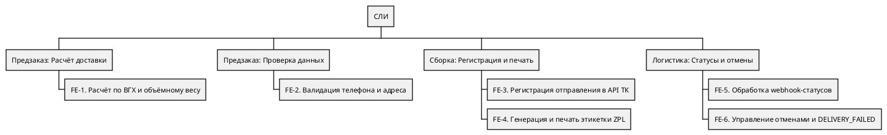
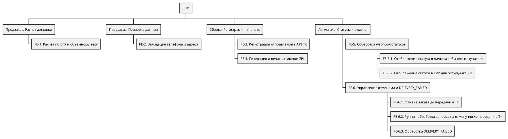
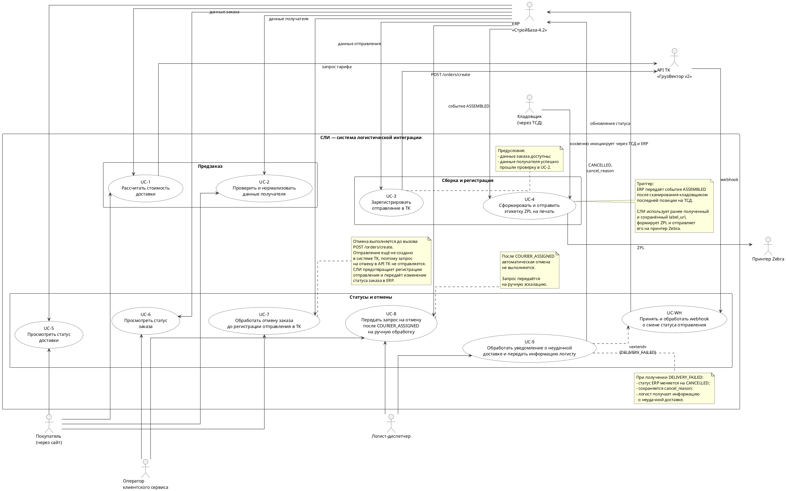
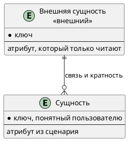

# Документ пользовательских требований

Вариант:  
Команда:  
Связанный документ концепции: `case_concept.md` (лабораторная работа 1)  
Дата:

Пользовательское требование фиксируется на уровне эпика. Каждый эпик оформлен и пользовательской историей, и сценарием использования.

## 1. Реинжиниринг дерева функций

Исходное дерево функций взято из документа концепции case_concept.md (раздел 4.2) без изменения формулировок и структуры. 
Диаграмма Mermaid преобразована в формат PlantUML WBS.

По результатам анализа концепции выделено девять пользовательских эпиков. Исходное дерево содержит все шесть основных функциональных узлов FE-1–FE-6, однако некоторые пользовательские цели в нём явно не раскрыты. Поэтому отдельные узлы необходимо добавить, а составные функции FE-5 и FE-6 — декомпозировать.

| ID эпика | Пользовательское требование | Узел дерева функций | Есть в дереве | Что сделано | Бизнес-цель |
|----------|-----------------------------|---------------------|---------------|-------------|-------------|
| **EP-1** | Расчёт стоимости доставки до оплаты | FE-1 | Да | Оставлен | BO-1 |
| **EP-2** | Проверка данных получателя | FE-2 | Да | Оставлен | Качество данных |
| **EP-3** | Автоматическая регистрация отправления | FE-3 | Да | Оставлен | BO-2, BO-4 |
| **EP-4** | Печать этикетки на складе | FE-4 | Да | Оставлен | BO-2 |
| **EP-5** | Просмотр статуса доставки покупателем | FE-5.1 | Нет (добавлен) | Выделено из FE-5 | BO-3 |
| **EP-6** | Просмотр статуса заказа сотрудником КЦ | FE-5.2 | Нет (добавлен) | Выделено из FE-5 | BO-3 |
| **EP-7** | Отмена заказа до передачи в ТК | FE-6.1 | Нет (добавлен) | Выделено из FE-6 | BO-5 |
| **EP-8** | Обработка запроса на отмену после передачи в ТК | FE-6.2 | Нет (добавлен) | Выделено из FE-6 | BO-5 |
| **EP-9** | Обработка неудачной доставки (DELIVERY_FAILED) | FE-6.3 | Нет (добавлен) | Выделено из FE-6 | BO-5 |

Скорректированное дерево функций:

В исходном дереве FE-5 описывает общий процесс приёма и обработки webhook-уведомлений от ТК. При реинжиниринге эта функция сохранена в качестве родительского узла и дополнена двумя подпунктами:

* **FE-5.1** — отображение актуального статуса доставки покупателю в личном кабинете;
* **FE-5.2** — отображение актуального статуса заказа сотруднику КЦ в ERP.

Таким образом, приём webhook и обновление статусов остаются общей функциональной основой FE-5 и не выделяются в отдельный пользовательский эпик.

Исходная FE-6 объединяет три самостоятельных сценария, поэтому она раскрыта через три подпункта:

* **FE-6.1** — обработка отмены заказа до передачи в ТК;
* **FE-6.2** — ручная обработка и эскалация запроса на отмену после передачи заказа перевозчику;
* **FE-6.3** — обработка уведомления о неудачной доставке DELIVERY_FAILED.

Автоматическая отмена после назначения курьера (`COURIER_ASSIGNED`) в MVP не предусматривается. В этом случае система блокирует автоматическое действие, а запрос передаётся на ручную эскалацию старшему логисту ТК.

**Соответствие диаграмме вариантов использования:** диаграмма строится по скорректированному дереву. Каждому пользовательскому эпику EP-1–EP-9 соответствует отдельный вариант использования. Родительские функции FE-5 и FE-6 служат группирующими узлами и не образуют самостоятельных вариантов использования. Это объясняет отсутствие отдельных прецедентов для FE-5 и FE-6 на диаграмме: их пользовательские цели раскрыты в подпунктах FE-5.1, FE-5.2, FE-6.1, FE-6.2 и FE-6.3.

## 2. Диаграмма вариантов использования

Исходник: `diagrams/usecase.puml`. Картинка без этого файла не принимается.

Граница системы:

| Узел дерева | Вариант использования | Актор / инициатор | Обоснование |
|-------------|----------------------|-------|--------------------------|
| FE-1 | UC-1. Рассчитать стоимость доставки | Покупатель, ERP, API ТК | Покупатель инициирует расчёт через сайт, ERP передаёт данные в СЛИ, СЛИ запрашивает тариф у API ТК. |
| FE-2 | UC-2. Проверить и нормализовать данные получателя | Покупатель, ERP | Покупатель вводит данные через сайт, ERP передаёт их в СЛИ. СЛИ выполняет проверку и нормализацию, возвращает результат в ERP. |
| FE-3 | UC-3. Зарегистрировать отправление в ТК | ERP, API ТК | ERP передаёт данные собранного заказа, СЛИ регистрирует отправление через API перевозчика и сохраняет `gv_tracking_number` и `label_url`. |
| FE-4 | UC-4. Сформировать и отправить этикетку ZPL на печать | ERP, принтер Zebra; кладовщик — косвенный инициатор | После сканирования последней позиции кладовщиком ERP переводит заказ в `ASSEMBLED` и передаёт событие в СЛИ. СЛИ формирует ZPL и отправляет его непосредственно на принтер Zebra. |
| FE-5.1 | UC-5. Просмотреть статус доставки | Покупатель, ERP; API ТК — источник статусов | API ТК отправляет webhook, СЛИ обрабатывает его в UC-WH и обновляет данные в ERP. Покупатель просматривает актуальный статус через сайт. |
| FE-5.2 | UC-6. Просмотреть статус заказа | Оператор клиентского сервиса, ERP; API ТК — источник статусов | СЛИ получает webhook от API ТК, обрабатывает его и обновляет сведения в ERP. Оператор просматривает актуальный статус заказа в ERP. |
| FE-6.1 | UC-7. Обработать отмену заказа до регистрации отправления в ТК | Покупатель — инициатор запроса, ERP | Покупатель направляет запрос через сайт, ERP передаёт его в СЛИ. Поскольку отправление ещё не создано в системе ТК, СЛИ не вызывает API отмены, предотвращает регистрацию отправления и передаёт изменение статуса заказа в ERP. |
| FE-6.2 | UC-8. Передать запрос на отмену после `COURIER_ASSIGNED` на ручную обработку | ERP, оператор КЦ, логист-диспетчер | ERP передаёт запрос в СЛИ. Автоматическая отмена не выполняется, запрос передаётся на ручную эскалацию. |
| FE-6.3 | UC-9. Обработать уведомление `DELIVERY_FAILED` | API ТК, ERP, логист-диспетчер | API ТК отправляет webhook. СЛИ обрабатывает уведомление, обновляет статус ERP на `CANCELLED`, сохраняет `cancel_reason` и передаёт информацию логисту. |

Границей рассматриваемой системы является **СЛИ — система логистической интеграции**. В качестве непосредственных внешних системных акторов выступают **ERP «СтройБаза-4.2»** и **API транспортной компании «ГрузВектор v2»**, поскольку именно с ними СЛИ осуществляет непосредственный обмен данными. Принтер Zebra представлен как внешнее техническое устройство, которому СЛИ отправляет сформированную этикетку ZPL.

**Покупатель**, **кладовщик**, **оператор клиентского сервиса** и **логист-диспетчер** являются участниками соответствующих бизнес-процессов. Покупатель взаимодействует с системой через сайт, кладовщик инициирует процесс печати посредством сканирования последней позиции на ТСД, после чего ERP передаёт событие ASSEMBLED в СЛИ. Оператор клиентского сервиса — через ERP, а логист-диспетчер получает информацию о запросах на ручную обработку отмен и о неудачной доставке.

## 3. Эпики

### EP-1. Расчёт стоимости доставки до оплаты

- Уровень: эпик
- Узел дерева: FE-1
- Бизнес-цель из документа концепции: BO-1
- Источник (стейкхолдер): Покупатель
- Приоритет MoSCoW: Must have

**Пользовательская история.** Как покупатель, я хочу видеть стоимость доставки до оплаты заказа (с учётом физического и объёмного веса), чтобы заранее понимать итоговые расходы.

**Сценарий использования UC-1.**

| Поле | Содержание |
|------|------------|
| Акторы | Покупатель, ERP, СЛИ, API ТК |
| Предусловия | В ERP заполнены ВГХ товаров. Товары добавлены в корзину. |
| Триггер | Покупатель нажимает «Оформить заказ» в корзине. |
| Постусловия успеха | Покупатель видит итоговую стоимость доставки. Заказ готов к оплате. |
| Постусловия отказа | Оформление заблокировано, покупатель видит сообщение об ошибке. |

Основной поток:

1. Покупатель добавляет товары в корзину и нажимает «Оформить заказ».
2. ERP запрашивает ВГХ товаров и рассчитывает вес по формуле max(физ. вес, объёмный вес).
3. ERP запрашивает стоимость доставки у СЛИ, а СЛИ вызывает метод `POST /calculator/tariff` и возвращает точную стоимость в ERP.
4. Сайт отображает покупателю итоговую стоимость.

Альтернативы:

1. Если у товара `length_mm = NULL`, ERP приостанавливает оформление и выводит сообщение: «Доставка этого товара временно недоступна».
2. Если API ТК недоступно (таймаут), СЛИ возвращает ошибку, ERP просит повторить попытку позже.
3. Если заказ оформляется после 13:00, ERP предлагает выбрать дату доставки на следующий день (согласно BR-4).

Исключения:

1. Если превышен лимит запросов к API ТК (5 rps), СЛИ ставит запрос в очередь, а сайт показывает лоадер (согласно NFR-P2).

---

### EP-2. Проверка и нормализация данных получателя

- Уровень: эпик
- Узел дерева: FE-2
- Бизнес-цель из документа концепции: BO-2 (Качество данных)
- Источник (стейкхолдер): Покупатель, Оператор КЦ
- Приоритет MoSCoW: Must have

**Пользовательская история.** Как покупатель, я хочу, чтобы мой телефон и адрес проверялись и автоматически приводились к нужному формату при оформлении, чтобы исключить отказы ТК из-за некорректных данных получателя.

**Сценарий использования UC-2.**

| Поле | Содержание |
|------|------------|
| Акторы | Покупатель, ERP, СЛИ |
| Предусловия | Заказ находится на этапе оформления, данные введены в ERP. |
| Триггер | ERP передаёт данные получателя в СЛИ для проверки. |
| Постусловия успеха | СЛИ подтверждает валидность, ERP сохраняет данные для дальнейшей отправки в ТК. |
| Постусловия отказа | СЛИ возвращает ошибку, ERP подсвечивает поле и блокирует оформление. |

Основной поток:

1. Покупатель вводит телефон и адрес в форме ERP.
2. ERP передаёт данные в СЛИ.
3. СЛИ нормализует телефон в формат E.164 (автоматически ставит `+7`).
4. СЛИ проверяет структуру адреса (город, улица, дом, корпус/строение).
5. СЛИ возвращает в ERP результат успешной валидации.
6. ERP сохраняет нормализованные данные и продолжает оформление.

Альтернативы:

1. Если телефон не соответствует формату, СЛИ возвращает ошибку. ERP подсвечивает поле красным и просит исправить.
2. Если в адресе не указан корпус, СЛИ возвращает ошибку. ERP просит уточнить адрес.

Исключения:

1. Если СЛИ недоступно, ERP блокирует оформление и формирует алерт для оператора КЦ (согласно RI-9).

---

### EP-3. Автоматическая регистрация отправления в ТК

- Уровень: эпик
- Узел дерева: FE-3
- Бизнес-цель из документа концепции: BO-2, BO-4
- Источник (стейкхолдер): Логист-диспетчер, Руководитель склада
- Приоритет MoSCoW: Must have

**Пользовательская история.** Как логист-диспетчер, я хочу, чтобы отправление регистрировалось в ТК автоматически после сборки, а трек-номер сохранялся в ERP, чтобы убрать ручной Excel.

**Сценарий использования UC-3.**

| Поле | Содержание |
|------|------------|
| Акторы | ERP, СЛИ, API ТК (Логист-диспетчер — заинтересованное лицо) |
| Предусловия | Заказ собран кладовщиком, статус в ERP изменен на `ASSEMBLED`. Данные получателя прошли валидацию (UC-2). |
| Триггер | СЛИ получает событие об изменении статуса на `ASSEMBLED`. |
| Постусловия успеха | В ERP сохранены `gv_tracking_number` и `label_url`. |
| Постусловия отказа | Заказ не зарегистрирован, оператор КЦ получает уведомление. |

Основной поток:

1. ERP переводит заказ в статус `ASSEMBLED`.
2. СЛИ перехватывает событие. Перед вызовом API ТК СЛИ проверяет, что данные получателя прошли валидацию (UC-2). Если данные невалидны — регистрация блокируется.
3. СЛИ ставит задачу в очередь и асинхронно вызывает `POST /orders/create`.
4. СЛИ передаёт `client_order_id` (защита от дублей), данные получателя и текстовый комментарий (если он есть).
5. СЛИ получает ответ от ТК и сохраняет `gv_tracking_number` и `label_url` в ERP через REST-шлюз.

Альтернативы:

1. Если ТК возвращает ошибку валидации (например, неверный формат телефона), СЛИ логирует её и уведомляет оператора.

Исключения:

1. Если API ТК недоступно (таймаут), СЛИ ставит задачу в очередь и повторяет попытку с экспоненциальной задержкой (до 5 раз). Работа склада не блокируется.

---

### EP-4. Печать этикетки на складе

- Уровень: эпик
- Узел дерева: FE-4
- Бизнес-цель из документа концепции: BO-2
- Источник (стейкхолдер): Кладовщик
- Приоритет MoSCoW: Must have

**Пользовательская история.** Как кладовщик, я хочу получать готовую этикетку (ZPL) после сборки, чтобы маркировать груз без ручной печати на А4 и скотча.

**Сценарий использования UC-4.**

| Поле | Содержание |
|------|------------|
| Акторы | Кладовщик, СЛИ, Термопринтер Zebra (устройство) |
| Предусловия | Заказ собран, статус `ASSEMBLED`. Трек-номер и `label_url` получены от ТК. |
| Триггер | СЛИ получает `label_url` от ТК. |
| Постусловия успеха | Этикетка напечатана на Zebra, наклеена на груз. |
| Постусловия отказа | Печать не удалась, кладовщик видит ошибку. |

Основной поток:

1. СЛИ использует полученный ранее `label_url` и формирует команду на печать в формате ZPL.
2. Принтер Zebra печатает этикетку.
3. Кладовщик забирает готовую этикетку и клеит на груз.

Альтернативы:

1. Если принтер недоступен (нет связи, замятие), на ТСД выводится сообщение об ошибке. Кладовщик меняет рулон и нажимает «Повторить печать». Заказ не нужно собирать заново

Исключения:

1. Если нет `label_url`, СЛИ делает повторный запрос к ТК (согласно AC-5). До реализации уточнить формат `label_url` и способ получения ZPL (согласно DE-6).

---

### EP-5. Просмотр статуса доставки покупателем

- Уровень: эпик
- Узел дерева: FE-5.1 (новый)
- Бизнес-цель из документа концепции: BO-3
- Источник (стейкхолдер): Покупатель
- Приоритет MoSCoW: Must have

**Пользовательская история.** Как покупатель, я хочу видеть актуальный статус доставки в личном кабинете, чтобы понимать, где мой заказ и не звонить в поддержку.

**Сценарий использования UC-5.**

| Поле | Содержание |
|------|------------|
| Акторы | Покупатель, Сайт, ERP, СЛИ, API ТК |
| Предусловия | Заказ передан в ТК, СЛИ настроен на приём вебхуков. |
| Триггер | СЛИ получает вебхук от ТК. |
| Постусловия успеха | Покупатель видит актуальный статус (например, «В пути»). |
| Постусловия отказа | Статус не отображается, клиент звонит в КЦ. |

Основной поток:

1. СЛИ получает вебхук от ТК о смене статуса.
2. СЛИ обновляет статус в ERP.
3. Сайт запрашивает данные из ERP через REST-шлюз и показывает статус покупателю в ЛК.

Альтернативы:

1. Если вебхук не поступил, статус обновляется фоновой задачей (cron) не чаще 1 раза в час, только для заказов без вебхука > 2 часов, пачками по 50 (согласно NFR-P3).

Исключения:

1. Если API ТК недоступно, покупатель видит последний известный статус.

---

### EP-6. Просмотр статуса заказа сотрудником КЦ

- Уровень: эпик
- Узел дерева: FE-5.2 (новый)
- Бизнес-цель из документа концепции: BO-3
- Источник (стейкхолдер): Оператор КЦ
- Приоритет MoSCoW: Must have

**Пользовательская история.** Как оператор КЦ, я хочу видеть актуальный статус доставки в ERP, чтобы давать клиенту достоверную информацию при обращении.

**Сценарий использования UC-6.**

| Поле | Содержание |
|------|------------|
| Акторы | Оператор КЦ, ERP, СЛИ |
| Предусловия | Заказ существует в ERP, отправление зарегистрировано, информация о статусе обновляется через СЛИ. |
| Триггер | Оператор открывает карточку заказа в ERP. |
| Постусловия успеха | Оператор называет клиенту актуальный статус. |
| Постусловия отказа | Оператор не может найти заказ или статус не обновлен. |

Основной поток:

1. Клиент звонит, оператор открывает заказ в ERP.
2. Оператор видит актуальный статус (благодаря вебхукам, обработанным СЛИ).
3. Оператор отвечает клиенту.

Альтернативы:

1. Если статус «завис», оператор видит алерт о том, что давно не было вебхука (порог времени уточнить).

---

### EP-7. Отмена заказа до передачи в ТК

- Уровень: эпик
- Узел дерева: FE-6.1 (новый)
- Бизнес-цель из документа концепции: BO-5
- Источник (стейкхолдер): Покупатель
- Приоритет MoSCoW: Must have

**Пользовательская история.** Как покупатель, я хочу отменить заказ до передачи перевозчику, чтобы прекратить обработку и получить возврат денежных средств.

**Сценарий использования UC-7.**

| Поле | Содержание |
|------|------------|
| Акторы | Покупатель, ERP |
| Предусловия | Заказ в статусе `NEW`, `CONFIRMED` или `ASSEMBLING`. |
| Триггер | Покупатель нажимает «Отменить заказ» в ЛК. |
| Постусловия успеха | Заказ отменен (`CANCELLED`), инициирован возврат денежных средств клиенту. |
| Постусловия отказа | Отмена заблокирована (заказ уже уехал). |

Основной поток:

1. Покупатель нажимает «Отменить заказ».
2. ERP проверяет статус и подтверждает, что заказ не передан в ТК.
3. ERP ставит статус `CANCELLED` и инициирует стандартную процедуру возврата денежных средств клиенту через платежный шлюз.

Альтернативы:

1. Если заказ уже передан в ТК, ERP блокирует отмену и перенаправляет в EP-8.

Исключения:

1. Если платежный шлюз недоступен, возврат ставится в очередь.

---

### EP-8. Обработка запроса на отмену после передачи в ТК

- Уровень: эпик
- Узел дерева: FE-6.2 (новый)
- Бизнес-цель из документа концепции: BO-5
- Источник (стейкхолдер): Оператор КЦ, Логист-диспетчер
- Приоритет MoSCoW: Must have

**Пользовательская история.** Как оператор КЦ, я хочу передавать запрос на отмену логисту-диспетчеру (если автоотмена недоступна), чтобы согласовать отмену с ТК и зафиксировать результат.

**Сценарий использования UC-8.**

| Поле | Содержание |
|------|------------|
| Акторы | Оператор КЦ, Логист-диспетчер, ERP, ТК «ГрузВектор v2» |
| Предусловия | Заказ в статусе `COURIER_ASSIGNED` (курьер назначен). |
| Триггер | Клиент звонит в КЦ с просьбой отменить заказ. |
| Постусловия успеха | Заказ отменен вручную, статус обновлен. |
| Постусловия отказа | ТК отказала в отмене, заказ едет дальше. |

Основной поток:

1. Оператор КЦ фиксирует обращение в ERP.
2. Задача эскалируется Логисту-диспетчеру.
3. Логист звонит старшему логисту ТК.
4. Если ТК подтверждает отмену, Логист вручную меняет статус в ERP на `CANCELLED`.

Альтернативы:

1. Если ТК отказывает, статус остается прежним, клиенту сообщается причина.

Исключения:

1. Если Логист не может дозвониться, система выводит повторный алерт для Логиста-диспетчера (согласно NFR-U1).

---

### EP-9. Обработка неудачной доставки (DELIVERY_FAILED)

- Уровень: эпик
- Узел дерева: FE-6.3 (новый)
- Бизнес-цель из документа концепции: BO-5
- Источник (стейкхолдер): Логист-диспетчер
- Приоритет MoSCoW: Must have

**Пользовательская история.** Как логист-диспетчер, я хочу получать информацию о неудачной доставке, чтобы инициировать ручную обработку возврата товара на склад.

**Сценарий использования UC-9.**

| Поле | Содержание |
|------|------------|
| Акторы | Логист-диспетчер, ERP, СЛИ, API ТК |
| Предусловия | Курьер выехал на доставку. |
| Триггер | ТК отправляет вебхук со статусом `DELIVERY_FAILED`. |
| Постусловия успеха | Заказ переведен в `CANCELLED` с причиной `delivery_failed`, создана задача для ручного возврата товара на склад. |
| Постусловия отказа | Вебхук не получен, статус не обновлен. |

Основной поток:

1. ТК присылает вебхук `DELIVERY_FAILED` на endpoint СЛИ.
2. СЛИ отвечает `200 OK` за 3 секунды и ставит задачу в очередь.
3. СЛИ асинхронно обновляет ERP: статус `CANCELLED`, причина `delivery_failed`.
4. Логист-диспетчер видит заказ в отчете и запускает ручной возврат товара на склад.

Альтернативы:

1. Если вебхук не пришел, фоновая задача (cron) вытягивает статус.

Исключения:

1. СЛИ логирует ошибку и формирует алерт для оператора КЦ (согласно NFR-U1).

## 4. Анализ сущностей

Сущности выводятся из сценариев эпиков. Актор, действие и правило сборки сущностью не становятся.

Исходник: `diagrams/logical-data.puml`.

| Сущность | Эпик или сценарий | Что хранит система | Ключ |
|----------|-------------------|--------------------|------|
| | | сама / только читает извне | |

| Связь | Кратность | Откуда это видно в постусловии |
|-------|-----------|--------------------------------|
| | | |

Что названо в сценарии и на схему не попало:

| Слово | Почему не сущность |
|-------|--------------------|
| | актор / атрибут / вне рамок / правило |

## 5. Проверка требований

### 5.1. Подготовка

Участники проверки:

| Роль | Кто |
|------|-----|
| Аналитик | Кузнецов И.Н. |
| Заказчик | Шустов Дмитрий |
| Разработчик | Зотьев А.Р. |
| Тестировщик | Фесенко Д.А. |

### 5.2. Полнота

| ID | Роль | Действие | Ценность | Контекст | Полнота | Что дополнить |
|----|------|----------|----------|----------|---------|---------------|
| EP-1 | Покупатель | Увидеть стоимость доставки до оплаты | Заранее понимать итоговые расходы | Товары в корзине, в ERP заполнены ВГХ | Полное | — |
| EP-2 | Покупатель | Проверить и нормализовать телефон и адрес | Исключить отказы ТК из-за некорректных данных | Заказ на этапе оформления | Полное | — |
| EP-3 | Логист-диспетчер | Автоматически зарегистрировать отправление в ТК | Убрать ручной Excel и сохранить трек-номер в ERP | Заказ собран (ASSEMBLED), данные валидны | Полное | — |
| EP-4 | Кладовщик | Получить готовую этикетку (ZPL) после сборки | Маркировать груз без ручной печати на А4 | Заказ собран, есть `label_url` | Полное | — |
| EP-5 | Покупатель | Видеть актуальный статус доставки в ЛК | Понимать, где заказ и не звонить в КЦ | Заказ передан в ТК, СЛИ принимает вебхуки | Полное | — |
| EP-6 | Оператор КЦ | Видеть актуальный статус доставки в ERP | Давать клиенту достоверную информацию | Заказ существует в ERP, СЛИ обновляет статус | Полное | — |
| EP-7 | Покупатель | Отменить заказ до передачи в ТК | Прекратить обработку и получить возврат денег | Заказ не передан в ТК | Полное | — |
| EP-8 | Оператор КЦ | Передать запрос на отмену логисту-диспетчеру | Согласовать отмену с ТК и зафиксировать результат | Заказ в статусе `COURIER_ASSIGNED` | Полное | — |
| EP-9 | Логист-диспетчер | Получить информацию о неудачной доставке | Инициировать ручной возврат товара на склад | Курьер выехал, пришел вебхук `DELIVERY_FAILED` | Полное | — |

### 5.3. Однозначность и проверяемость

| Исходное требование | Проблема | Исправленное требование |
|---------------------|----------|-------------------------|
| EP-1 (первоначальная формулировка): «Как покупатель, я хочу видеть стоимость доставки до оплаты заказа...» | Было не указано, что расчет должен учитывать физический и объёмный вес, что приводило бы к той же ошибке, что и на сайте. | EP-1: «Как покупатель, я хочу видеть стоимость доставки до оплаты заказа (с учётом физического и объёмного веса), чтобы заранее понимать итоговые расходы». |
| EP-6 (первоначальная формулировка): «Как оператор КЦ, я хочу видеть статус заказа...» | Не был указан источник данных (ERP), из-за чего было неясно, куда смотреть оператору. | EP-6: «Как оператор КЦ, я хочу видеть актуальный статус доставки в ERP, чтобы давать клиенту достоверную информацию при обращении». |
| EP-9 (первоначальная формулировка): «Как логист, я хочу получать информацию о неудачной доставке...» | Не было указано, что именно создается задача на ручной возврат, что противоречило бы Out of Scope. | EP-9: «Как логист-диспетчер, я хочу получать информацию о неудачной доставке, чтобы инициировать ручную обработку возврата товара на склад». |

### 5.4. Непротиворечивость

| Требование A | Требование B | Конфликт | Решение |
|--------------|--------------|----------|---------|
| | | нет / описать | |

### 5.5. Атомарность

| Исходное требование | Проблема | Как разделено или почему оставлено одним эпиком |
|---------------------|----------|--------------------------------------------------|
| | | |

### 5.6. Трассируемость

| ID | Требование | Источник | Бизнес-цель | Узел дерева | Вариант использования | Статус |
|----|------------|----------|-------------|-------------|----------------------|--------|
| EP-1 | | | | | UC-1 | |

### 5.7. Приоритет

| ID | Требование | Приоритет | Обоснование |
|----|------------|-----------|-------------|
| EP-1 | | Must / Should / Could / Won't | |

### 5.8. Ревью со стейкхолдерами

| Замечание | Кто высказал | Решение | Что изменено в документе |
|-----------|--------------|---------|--------------------------|
| | | принято / отклонено | |

### 5.9. Разбор с помощью ИИ

Инструмент:

Промпт:

Ответ модели:

| Замечание модели | Тип (неоднозначность, противоречие, дубль, пробел) | Принято | Куда внесено |
|------------------|----------------------------------------------------|---------|--------------|
| | | да / нет | |

### 5.10. Протокол проверки

| ID | Дефект | Тип дефекта | Рекомендация | Статус |
|----|--------|-------------|--------------|--------|
| | | | | открыт / исправлено |

## 6. Чек-лист по каждому эпику

| № | Критерий | EP-1 | Комментарий |
|---|----------|------|-------------|
| 1 | Указана роль пользователя | да / нет | |
| 2 | Указано действие | да / нет | |
| 3 | Указана ценность | да / нет | |
| 4 | Требование однозначно | да / нет | |
| 5 | Требование проверяемо | да / нет | |
| 6 | Требование атомарно | да / нет | |
| 7 | Требование не противоречит другим | да / нет | |
| 8 | Требование имеет уникальный ID | да / нет | |
| 9 | Указан источник требования | да / нет | |
| 10 | Указан приоритет | да / нет | |
| 11 | Требование реализуемо | да / нет | |
| 12 | Требование актуально | да / нет | |

Колонки эпиков добавляются по числу требований.

## 7. Перечень после проверки

Актуальные формулировки эпиков, историй и сценариев после исправлений. Устаревшие формулировки в этот перечень не копируются: они остаются в протоколе.
