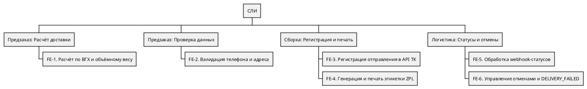
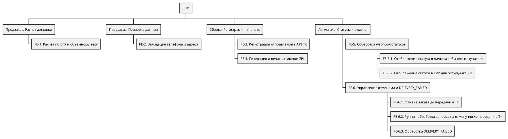
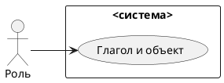
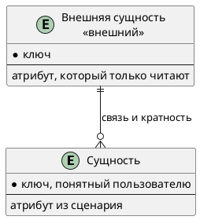

# Документ пользовательских требований

Вариант:  
Команда:  
Связанный документ концепции: `case_concept.md` (лабораторная работа 1)  
Дата:

Пользовательское требование фиксируется на уровне эпика. Каждый эпик оформлен и пользовательской историей, и сценарием использования.

## 1. Реинжиниринг дерева функций

Исходное дерево функций взято из документа концепции case_concept.md (раздел 4.2) без изменения формулировок и структуры. 
Диаграмма Mermaid преобразована в формат PlantUML WBS.

По результатам анализа концепции выделено девять пользовательских эпиков. Исходное дерево содержит все шесть основных функциональных узлов FE-1–FE-6, однако некоторые пользовательские цели в нём явно не раскрыты. Поэтому отдельные узлы необходимо добавить, а составные функции FE-5 и FE-6 — декомпозировать.

| ID эпика | Пользовательское требование | Узел дерева функций | Есть в дереве | Что сделано | Бизнес-цель |
|----------|-----------------------------|---------------------|---------------|-------------|-------------|
| **EP-1** | Расчёт стоимости доставки до оплаты | FE-1 | Да | Оставлен | BO-1 |
| **EP-2** | Проверка данных получателя | FE-2 | Да | Оставлен | Качество данных |
| **EP-3** | Автоматическая регистрация отправления | FE-3 | Да | Оставлен | BO-2, BO-4 |
| **EP-4** | Печать этикетки на складе | FE-4 | Да | Оставлен | BO-2 |
| **EP-5** | Просмотр статуса доставки покупателем | FE-5.1 | Нет (добавлен) | Выделено из FE-5 | BO-3 |
| **EP-6** | Просмотр статуса заказа сотрудником КЦ | FE-5.2 | Нет (добавлен) | Выделено из FE-5 | BO-3 |
| **EP-7** | Отмена заказа до передачи в ТК | FE-6.1 | Нет (добавлен) | Выделено из FE-6 | BO-5 |
| **EP-8** | Обработка запроса на отмену после передачи в ТК | FE-6.2 | Нет (добавлен) | Выделено из FE-6 | BO-5 |
| **EP-9** | Обработка неудачной доставки (DELIVERY_FAILED) | FE-6.3 | Нет (добавлен) | Выделено из FE-6 | BO-5 |

Скорректированное дерево функций:

В исходном дереве FE-5 описывает общий процесс приёма и обработки webhook-уведомлений от ТК. При реинжиниринге эта функция сохранена в качестве родительского узла и дополнена двумя подпунктами:

* **FE-5.1** — отображение актуального статуса доставки покупателю в личном кабинете;
* **FE-5.2** — отображение актуального статуса заказа сотруднику КЦ в ERP.

Таким образом, приём webhook и обновление статусов остаются общей функциональной основой FE-5 и не выделяются в отдельный пользовательский эпик.

Исходная FE-6 объединяет три самостоятельных сценария, поэтому она раскрыта через три подпункта:

* **FE-6.1** — обработка отмены заказа до передачи в ТК;
* **FE-6.2** — ручная обработка и эскалация запроса на отмену после передачи заказа перевозчику;
* **FE-6.3** — обработка уведомления о неудачной доставке DELIVERY_FAILED.

Автоматическая отмена после назначения курьера (`COURIER_ASSIGNED`) в MVP не предусматривается. В этом случае система блокирует автоматическое действие, а запрос передаётся на ручную эскалацию старшему логисту ТК.

**Соответствие диаграмме вариантов использования:** диаграмма строится по скорректированному дереву. Каждому пользовательскому эпику EP-1–EP-9 соответствует отдельный вариант использования. Родительские функции FE-5 и FE-6 служат группирующими узлами и не образуют самостоятельных вариантов использования. Это объясняет отсутствие отдельных прецедентов для FE-5 и FE-6 на диаграмме: их пользовательские цели раскрыты в подпунктах FE-5.1, FE-5.2, FE-6.1, FE-6.2 и FE-6.3.

## 2. Диаграмма вариантов использования

Исходник: `diagrams/usecase.puml`. Картинка без этого файла не принимается.

Граница системы:

| Узел дерева | Вариант использования | Актор |
|-------------|----------------------|-------|
| | UC-1 | |

## 3. Эпики

### EP-1. Расчёт стоимости доставки до оплаты

- Уровень: эпик
- Узел дерева: FE-1
- Бизнес-цель из документа концепции: BO-1
- Источник (стейкхолдер): Покупатель
- Приоритет MoSCoW: Must have

**Пользовательская история.** Как покупатель, я хочу видеть стоимость доставки до оплаты заказа (с учётом физического и объёмного веса), чтобы заранее понимать итоговые расходы.

**Сценарий использования UC-1.**

| Поле | Содержание |
|------|------------|
| Акторы | Покупатель, ERP, СЛИ, API ТК |
| Предусловия | В ERP заполнены ВГХ товаров. Товары добавлены в корзину. |
| Триггер | Покупатель нажимает «Оформить заказ» в корзине. |
| Постусловия успеха | Покупатель видит итоговую стоимость доставки. Заказ готов к оплате. |
| Постусловия отказа | Оформление заблокировано, покупатель видит сообщение об ошибке. |

Основной поток:

1. Покупатель добавляет товары в корзину и нажимает «Оформить заказ».
2. ERP запрашивает ВГХ товаров и рассчитывает вес по формуле max(физ. вес, объёмный вес).
3. ERP запрашивает стоимость доставки у СЛИ, а СЛИ вызывает метод `POST /calculator/tariff` и возвращает точную стоимость в ERP.
4. Сайт отображает покупателю итоговую стоимость.

Альтернативы:

1. Если у товара `length_mm = NULL`, ERP приостанавливает оформление и выводит сообщение: «Доставка этого товара временно недоступна».
2. Если API ТК недоступно (таймаут), СЛИ возвращает ошибку, ERP просит повторить попытку позже.
3. Если заказ оформляется после 13:00, ERP предлагает выбрать дату доставки на следующий день (согласно BR-4).

Исключения:

1. Если превышен лимит запросов к API ТК (5 rps), СЛИ ставит запрос в очередь, а сайт показывает лоадер (согласно NFR-P2).

---

### EP-2. Проверка и нормализация данных получателя

- Уровень: эпик
- Узел дерева: FE-2
- Бизнес-цель из документа концепции: BO-2 (Качество данных)
- Источник (стейкхолдер): Покупатель, Оператор КЦ
- Приоритет MoSCoW: Must have

**Пользовательская история.** Как покупатель, я хочу, чтобы мой телефон и адрес проверялись и автоматически приводились к нужному формату при оформлении, чтобы исключить отказы ТК из-за некорректных данных получателя.

**Сценарий использования UC-2.**

| Поле | Содержание |
|------|------------|
| Акторы | Покупатель, ERP, СЛИ |
| Предусловия | Заказ находится на этапе оформления, данные введены в ERP. |
| Триггер | ERP передаёт данные получателя в СЛИ для проверки. |
| Постусловия успеха | СЛИ подтверждает валидность, ERP сохраняет данные для дальнейшей отправки в ТК. |
| Постусловия отказа | СЛИ возвращает ошибку, ERP подсвечивает поле и блокирует оформление. |

Основной поток:

1. Покупатель вводит телефон и адрес в форме ERP.
2. ERP передаёт данные в СЛИ.
3. СЛИ нормализует телефон в формат E.164 (автоматически ставит `+7`).
4. СЛИ проверяет структуру адреса (город, улица, дом, корпус/строение).
5. СЛИ возвращает в ERP результат успешной валидации.
6. ERP сохраняет нормализованные данные и продолжает оформление.

Альтернативы:

1. Если телефон не соответствует формату, СЛИ возвращает ошибку. ERP подсвечивает поле красным и просит исправить.
2. Если в адресе не указан корпус, СЛИ возвращает ошибку. ERP просит уточнить адрес.

Исключения:

1. Если СЛИ недоступно, ERP блокирует оформление и формирует алерт для оператора КЦ (согласно RI-9).

---

## 4. Анализ сущностей

Сущности выводятся из сценариев эпиков. Актор, действие и правило сборки сущностью не становятся.

Исходник: `diagrams/logical-data.puml`.

| Сущность | Эпик или сценарий | Что хранит система | Ключ |
|----------|-------------------|--------------------|------|
| | | сама / только читает извне | |

| Связь | Кратность | Откуда это видно в постусловии |
|-------|-----------|--------------------------------|
| | | |

Что названо в сценарии и на схему не попало:

| Слово | Почему не сущность |
|-------|--------------------|
| | актор / атрибут / вне рамок / правило |

## 5. Проверка требований

### 5.1. Подготовка

Участники проверки:

| Роль | Кто |
|------|-----|
| Аналитик | |
| Заказчик | |
| Разработчик | |
| Тестировщик | |

### 5.2. Полнота

| ID | Роль | Действие | Ценность | Контекст | Полнота | Что дополнить |
|----|------|----------|----------|----------|---------|---------------|
| EP-1 | | | | | | |

### 5.3. Однозначность и проверяемость

| Исходное требование | Проблема | Исправленное требование |
|---------------------|----------|-------------------------|
| | | |

### 5.4. Непротиворечивость

| Требование A | Требование B | Конфликт | Решение |
|--------------|--------------|----------|---------|
| | | нет / описать | |

### 5.5. Атомарность

| Исходное требование | Проблема | Как разделено или почему оставлено одним эпиком |
|---------------------|----------|--------------------------------------------------|
| | | |

### 5.6. Трассируемость

| ID | Требование | Источник | Бизнес-цель | Узел дерева | Вариант использования | Статус |
|----|------------|----------|-------------|-------------|----------------------|--------|
| EP-1 | | | | | UC-1 | |

### 5.7. Приоритет

| ID | Требование | Приоритет | Обоснование |
|----|------------|-----------|-------------|
| EP-1 | | Must / Should / Could / Won't | |

### 5.8. Ревью со стейкхолдерами

| Замечание | Кто высказал | Решение | Что изменено в документе |
|-----------|--------------|---------|--------------------------|
| | | принято / отклонено | |

### 5.9. Разбор с помощью ИИ

Инструмент:

Промпт:

Ответ модели:

| Замечание модели | Тип (неоднозначность, противоречие, дубль, пробел) | Принято | Куда внесено |
|------------------|----------------------------------------------------|---------|--------------|
| | | да / нет | |

### 5.10. Протокол проверки

| ID | Дефект | Тип дефекта | Рекомендация | Статус |
|----|--------|-------------|--------------|--------|
| | | | | открыт / исправлено |

## 6. Чек-лист по каждому эпику

| № | Критерий | EP-1 | Комментарий |
|---|----------|------|-------------|
| 1 | Указана роль пользователя | да / нет | |
| 2 | Указано действие | да / нет | |
| 3 | Указана ценность | да / нет | |
| 4 | Требование однозначно | да / нет | |
| 5 | Требование проверяемо | да / нет | |
| 6 | Требование атомарно | да / нет | |
| 7 | Требование не противоречит другим | да / нет | |
| 8 | Требование имеет уникальный ID | да / нет | |
| 9 | Указан источник требования | да / нет | |
| 10 | Указан приоритет | да / нет | |
| 11 | Требование реализуемо | да / нет | |
| 12 | Требование актуально | да / нет | |

Колонки эпиков добавляются по числу требований.

## 7. Перечень после проверки

Актуальные формулировки эпиков, историй и сценариев после исправлений. Устаревшие формулировки в этот перечень не копируются: они остаются в протоколе.
