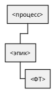

# Документ функциональных требований

Вариант:  
Команда:  
Источник: `Документ пользовательских требований.md`  
Дата:

## 1. Декомпозиция

| История | Функциональные требования |
|---------|---------------------------|
| **EP-1. Расчёт стоимости доставки до оплаты** | **ФТ-1.1:** Система должна принимать от ERP запрос на расчёт стоимости доставки с параметрами грузового места, подготовленными ERP (вес, габариты).<br>**ФТ-1.2:** Система должна запрашивать тариф у API ТК методом `POST /calculator/tariff` и возвращать рассчитанную стоимость в ERP. |
| **EP-2. Проверка и нормализация данных получателя** | **ФТ-2.1:** Система должна нормализовывать телефон получателя в формат E.164.<br>**ФТ-2.2:** Система должна нормализовывать адрес получателя, разбивая его на структурированные поля (город, улица, дом, корпус/строение, квартира).<br>**ФТ-2.3:** Система должна проверять корректность заполнения полей телефона и адреса и возвращать в ERP результат проверки вместе с нормализованными данными. |
| **EP-3. Автоматическая регистрация отправления в ТК** | **ФТ-3.1:** Система должна получать событие о смене статуса заказа на `ASSEMBLED`.<br>**ФТ-3.2:** Система должна проверять, что данные получателя прошли валидацию (ФТ-2.3), перед регистрацией отправления.<br>**ФТ-3.3:** Система должна ставить задачу регистрации в очередь и асинхронно вызывать `POST /orders/create`, передавая `client_order_id`, данные получателя и текстовый комментарий, если он есть.<br>**ФТ-3.4:** Система должна сохранять полученные `gv_tracking_number` и `label_url` в ERP через REST-шлюз.<br>**ФТ-3.5:** Система должна при получении ошибки валидации от API ТК регистрировать ошибку и создавать задачу в очереди ошибок для оператора КЦ. |
| **EP-4. Печать этикетки на складе** | **ФТ-4.1:** Система должна при получении `label_url` формировать команду печати в формате ZPL.<br>**ФТ-4.2:** Система должна отправлять сформированный ZPL на принтер Zebra, а при поступлении запроса на повторную печать повторно отправлять этикетку без необходимости повторной сборки заказа. |
| **EP-5. Просмотр статуса доставки покупателем** | **ФТ-5.1:** Система должна принимать webhook от ТК о смене статуса, отвечать `200 OK` и ставить событие в очередь.<br>**ФТ-5.2:** Система должна асинхронно обновлять статус заказа в ERP на основе полученного webhook.<br>**ФТ-5.3:** Система должна выполнять фоновый опрос статусов (cron) для заказов без webhook более 2 часов не чаще 1 раза в час. |
| **EP-6. Просмотр статуса заказа сотрудником КЦ** | **ФТ-5.2** (обновление статуса в ERP — используется из EP-5).<br>**ФТ-6.1:** Система должна формировать алерт для оператора КЦ, если по заказу не поступало webhook-уведомлений в течение установленного порога времени. |
| **EP-7. Отмена заказа до передачи в ТК** | **ФТ-7.1:** Система должна при получении от ERP информации об отмене заказа до вызова `POST /orders/create` предотвращать регистрацию отправления в API ТК, в том числе не отправлять ожидающую задачу регистрации, если она уже создана. |
| **EP-8. Обработка запроса на отмену после передачи в ТК** | **ФТ-8.1:** Система должна при получении запроса на отмену после `COURIER_ASSIGNED` создавать задачу для логиста-диспетчера. |
| **EP-9. Обработка неудачной доставки (`DELIVERY_FAILED`)** | **ФТ-9.1:** Система должна принимать webhook `DELIVERY_FAILED`, отвечать `200 OK` и ставить событие в очередь.<br>**ФТ-9.2:** Система должна асинхронно обновлять заказ в ERP: статус `CANCELLED`, `cancel_reason = delivery_failed`, и создавать задачу на ручной возврат товара на склад. |
| **EP-10. Просмотр данных зарегистрированного отправления** | **ФТ-3.4** (сохранение `gv_tracking_number` и `label_url` в ERP — используется из EP-3). |

## 2. Спецификация функций

### ФТ-1.1

- Формулировка: Система должна…
- История-источник:
- Актор:
- Вход:
- Результат:
- Ошибочный вход:
- Приоритет MoSCoW:
- Обоснование приоритета:

```text
Given:
When:
Then:
```

## 3. Схема декомпозиции

Исходник: `diagrams/decomposition.puml`. Идентификаторы на схеме те же, что в разделе 2.



## 4. Оценки сложности

| ID | Тип (EI, EO, EQ, ILF, EIF) | Сложность и почему | Функциональные точки | Карты покера | Пользовательские поинты | Что раздувает оценку |
|----|----------------------------|--------------------|----------------------|--------------|-------------------------|----------------------|
| ФТ-1.1 | | | | | | |

Сумма функциональных точек:  
Сумма пользовательских поинтов:

Внутренние и внешние группы данных, посчитанные один раз:

| Группа данных | ILF или EIF | Сложность | Точки | Какие функции её используют |
|---------------|-------------|-----------|-------|-----------------------------|
| | | | | |

## 5. Матрица трассировки

Колонка нефункциональных требований заполняется в лабораторной работе 4.

| ID | Тип | Источник | Связанные ФТ | Приоритет | Критерий приёмки | FP | Поинты |
|----|-----|----------|--------------|-----------|------------------|----|--------|
| | Пользовательское | | | | | | |

## 6. Выводы

Какие функции дают основной объём в точках. Какие функции дороги в поинтах при небольшом объёме данных. Что из этого команда берёт в ближайший выпуск.
