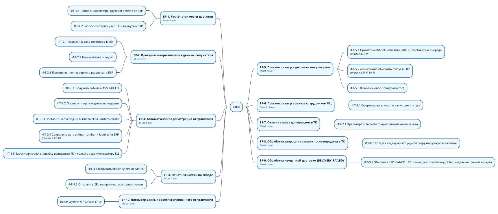

# Документ функциональных требований

| Поле | Значение |
|------|----------|
| Вариант | 07 - Склад |
| Команда | Зотьев А.Р ; Фесенко Д.А. ; Кузнецов И.Н. |
| Источник | `Документ пользовательских требований.md` | 
| Дата | 20.11.2026 |

## 1. Декомпозиция

В роли системы выступает СЛИ — система логистической интеграции.

| История | Функциональные требования |
|---------|---------------------------|
| **EP-1. Расчёт стоимости доставки до оплаты** | **ФТ-1.1:** Система должна принимать от ERP запрос на расчёт стоимости доставки с параметрами грузового места, подготовленными ERP (вес, габариты).<br>**ФТ-1.2:** Система должна запрашивать тариф у API ТК методом `POST /calculator/tariff` и возвращать рассчитанную стоимость в ERP. |
| **EP-2. Проверка и нормализация данных получателя** | **ФТ-2.1:** Система должна нормализовывать телефон получателя в формат E.164.<br>**ФТ-2.2:** Система должна нормализовывать адрес получателя, разбивая его на структурированные поля (город, улица, дом, корпус/строение, квартира).<br>**ФТ-2.3:** Система должна проверять корректность заполнения полей телефона и адреса и возвращать в ERP результат проверки вместе с нормализованными данными. |
| **EP-3. Автоматическая регистрация отправления в ТК** | **ФТ-3.1:** Система должна получать событие о смене статуса заказа на `ASSEMBLED`.<br>**ФТ-3.2:** Система должна проверять, что данные получателя прошли валидацию (ФТ-2.3), перед регистрацией отправления.<br>**ФТ-3.3:** Система должна ставить задачу регистрации в очередь и асинхронно вызывать `POST /orders/create`, передавая `client_order_id`, данные получателя и текстовый комментарий, если он есть.<br>**ФТ-3.4:** Система должна сохранять полученные `gv_tracking_number` и `label_url` в ERP через REST-шлюз.<br>**ФТ-3.5:** Система должна при получении ошибки валидации от API ТК регистрировать ошибку и создавать задачу в очереди ошибок для оператора КЦ. |
| **EP-4. Печать этикетки на складе** | **ФТ-4.1:** Система должна получать этикетку ZPL методом `GET /api/v2/orders/{gv_tracking_number}/label?format=zpl`<br>**ФТ-4.2:** Система должна отправлять сформированный ZPL на принтер Zebra, а при поступлении запроса на повторную печать повторно отправлять этикетку без необходимости повторной сборки заказа. |
| **EP-5. Просмотр статуса доставки покупателем** | **ФТ-5.1:** Система должна принимать webhook от ТК о смене статуса, отвечать `200 OK` и ставить событие в очередь.<br>**ФТ-5.2:** Система должна асинхронно обновлять статус заказа в ERP на основе полученного webhook.<br>**ФТ-5.3:** Система должна выполнять фоновый опрос статусов (cron) для заказов без webhook более 2 часов не чаще 1 раза в час. |
| **EP-6. Просмотр статуса заказа сотрудником КЦ** | **ФТ-5.2** (обновление статуса в ERP — используется из EP-5).<br>**ФТ-6.1:** Система должна формировать алерт для оператора КЦ, если по заказу не поступало webhook-уведомлений в течение установленного порога времени. |
| **EP-7. Отмена заказа до передачи в ТК** | **ФТ-7.1:** Система должна при получении от ERP информации об отмене заказа до вызова `POST /orders/create` предотвращать регистрацию отправления в API ТК, в том числе не отправлять ожидающую задачу регистрации, если она уже создана. |
| **EP-8. Обработка запроса на отмену после передачи в ТК** | **ФТ-8.1:** Система должна при получении запроса на отмену после `COURIER_ASSIGNED` создавать задачу для логиста-диспетчера. |
| **EP-9. Обработка неудачной доставки (`DELIVERY_FAILED`)** | **ФТ-5.1** (общий приём webhook от ТК — используется и для DELIVERY_FAILED).<br>**ФТ-9.1:** Система должна асинхронно обновлять заказ в ERP: статус `CANCELLED`, `cancel_reason = delivery_failed`, и создавать задачу на ручной возврат товара на склад. |
| **EP-10. Просмотр данных зарегистрированного отправления** | **ФТ-3.4** (сохранение `gv_tracking_number` и `label_url` в ERP — используется из EP-3). |

## 2. Спецификация функций

## 2. Спецификация функций

В роли системы выступает СЛИ — система логистической интеграции. ERP «СтройБаза-4.2», API ТК «ГрузВектор v2», сайт, ТСД и принтер рассматриваются как внешние системы или устройства. СЛИ не выполняет действия, закреплённые за интерфейсами ERP и сайта, а передаёт им результаты своей обработки.

### ФТ-1.1

- **Формулировка:** Система должна принимать от ERP запрос на расчёт стоимости доставки с параметрами грузового места, подготовленными ERP (вес, габариты).
- **История-источник:** EP-1. Расчёт стоимости доставки до оплаты.
- **Актор:** ERP «СтройБаза-4.2»; покупатель — косвенный инициатор расчёта через оформление заказа.
- **Вход:** Запрос ERP, содержащий ФИАС города отправления `sender_city_fias`, адрес получателя `receiver_address` и массив грузовых мест `cargo_places` с физическим весом и габаритами каждого места. Исходные значения могут поступать из ERP в граммах и миллиметрах.
- **Результат:** СЛИ принимает запрос, проверяет полноту исходных данных и подготавливает параметры для обращения к калькулятору ТК. СЛИ преобразует единицы измерения в соответствии с контрактом API: граммы — в килограммы, миллиметры — в метры. Расчёт `max(физический вес, объёмный вес)` выполняет калькулятор ТК, которому передаются физический вес и габариты; СЛИ не подменяет его собственным расчётом.
- **Ошибочный вход:** Если отсутствуют обязательные ВГХ (в частности, одно или несколько измерений имеют значение `NULL`), СЛИ не подставляет средние или условные значения и возвращает ERP ошибку, из-за которой оформление доставки блокируется до исправления карточки товара. Если вес отдельного грузового места превышает 1500 кг, СЛИ возвращает ошибку с сообщением «Требуется помощь оператора»; автоматическое деление заказа на грузовые места не выполняется. Габарит более 2,2 м сам по себе не является причиной блокировки: он передаётся калькулятору ТК для расчёта предусмотренной наценки.
- **Приоритет MoSCoW:** Must have.
- **Обоснование приоритета:** Без корректных параметров грузовых мест нельзя получить достоверную стоимость доставки. Блокировка при отсутствии ВГХ и превышении предельного веса предотвращает расчёт заведомо некорректного тарифа и повторение инцидента с заказом весом 2500 кг.

```text
Given: ERP подготавливает запрос на расчёт стоимости доставки, содержащий идентификатор населённого пункта отправления по ФИАС, адрес получателя и параметры грузовых мест.
When: ERP передаёт запрос в СЛИ
Then: СЛИ проверяет обязательные параметры и преобразует вес из граммов в килограммы, а габариты из миллиметров в метры; при отсутствующих ВГХ или весе одного места свыше 1500 кг возвращает ошибку и не передаёт запрос калькулятору ТК
```

### ФТ-1.2

- **Формулировка:** Система должна запрашивать тариф у API ТК методом `POST /api/v2/calculator/tariff` и возвращать рассчитанную стоимость в ERP.
- **История-источник:** EP-1. Расчёт стоимости доставки до оплаты.
- **Актор:** API ТК «ГрузВектор v2», ERP «СтройБаза-4.2».
- **Вход:** Проверенные и подготовленные по ФТ-1.1 параметры: `sender_city_fias`, `receiver_address`, `cargo_places` с весом в килограммах и габаритами в метрах.
- **Результат:** СЛИ вызывает документированный метод `POST /api/v2/calculator/tariff`, получает точную стоимость доставки и возвращает её в ERP до оплаты заказа. Расчёт по `max(M_real, M_vol)` и наценку 40% при превышении любого габарита 2,2 м выполняет API ТК. СЛИ ограничивает частоту обращений к калькулятору значением не более 5 запросов в секунду на аккаунт. Запрос выполняется при обращении за расчётом на этапе оформления, а не при каждом изменении корзины.
- **Ошибочный вход:** При ошибке формата или неполноте параметров СЛИ возвращает ERP ошибку, не запрашивая тариф. При недоступности API ТК СЛИ возвращает ERP информацию о невозможности получить стоимость. При достижении лимита 5 запросов в секунду запрос ожидает возможности отправки в очереди ограничения частоты; до получения точного ответа ERP не должна показывать приблизительную стоимость или разрешать оплату с неподтверждённым тарифом. Правило кэширования тарифа не считается согласованным и не используется как основание для показа устаревшей цены без отдельного утверждения.
- **Приоритет MoSCoW:** Must have.
- **Обоснование приоритета:** Получение фактического тарифа до оплаты — основная цель EP-1 и необходимое условие устранения расхождения между расчётной и фактической стоимостью доставки.

```text
Given: СЛИ получила от ERP проверенные параметры отправления в единицах API
When: СЛИ вызывает POST /api/v2/calculator/tariff с sender_city_fias, receiver_address и cargo_places
Then: СЛИ получает рассчитанную API ТК стоимость доставки и возвращает её в ERP; при ожидании из-за лимита или недоступности API неподтверждённая стоимость не выдаётся
```

### ФТ-2.1

- **Формулировка:** Система должна нормализовывать телефон получателя в формат E.164.
- **История-источник:** EP-2. Проверка и нормализация данных получателя.
- **Актор:** ERP «СтройБаза-4.2»; покупатель — источник исходного номера телефона.
- **Вход:** Номер телефона получателя, переданный ERP.
- **Результат:** СЛИ приводит российский номер к формату E.164 (`+7XXXXXXXXXX`) по следующим правилам: если после удаления разделителей получено 11 цифр и первая цифра — `8`, начальная `8` заменяется на `+7`; если получено 10 цифр, впереди добавляется `+7`; если номер уже имеет формат `+7` и содержит 10 цифр после кода страны, он сохраняется без изменения. Номер из 11 цифр, начинающийся с `7`, преобразуется в `+7` и оставшиеся 10 цифр.
- **Ошибочный вход:** Если количество цифр или структура номера не соответствует перечисленным правилам, СЛИ возвращает ERP ошибку валидации. Некорректный номер не передаётся в ТК. Автоматическое добавление `+7` к произвольной последовательности цифр не выполняется.
- **Приоритет MoSCoW:** Must have.
- **Обоснование приоритета:** Правильная нормализация телефона необходима для прохождения проверки ТК и предотвращения зависания заказа из-за формата `8-916-...` вместо `+7916...`.

```text
Given: ERP передала в СЛИ российский номер телефона, состоящий из 11 цифр и начинающийся с 8
When: СЛИ нормализует номер
Then: СЛИ заменяет начальную 8 на +7 и возвращает номер в формате E.164; если длина или структура номера не соответствует правилам, СЛИ возвращает ошибку
```

### ФТ-2.2

- **Формулировка:** Система должна нормализовывать адрес получателя, разбивая его на структурированные поля (город, улица, дом, корпус/строение, квартира).
- **История-источник:** EP-2. Проверка и нормализация данных получателя.
- **Актор:** ERP «СтройБаза-4.2»; покупатель — источник исходного адреса.
- **Вход:** Адрес получателя в виде строки, переданный ERP.
- **Результат:** СЛИ разбивает адрес на структурированные поля города, улицы, дома и корпуса/строения. Если в адресе указана литера, она сохраняется в составе соответствующего адресного значения и не теряется при нормализации. Квартира/офис указывается при наличии. Лишние пробелы и недопустимые символы удаляются или нормализуются в соответствии с форматом адреса ТК.
- **Ошибочный вход:** Если отсутствует обязательная часть адреса (в том числе корпус/строение, указанное как обязательное в сценарии EP-2), адрес невозможно разобрать на требуемые поля либо присутствуют недопустимые символы, СЛИ возвращает ERP ошибку. Литера не должна отбрасываться или ошибочно трактоваться как отдельный корпус. Обязательность квартиры/офиса должна соответствовать согласованному контракту адреса ТК; отсутствие квартиры само по себе не объявляется ошибкой, если квартира/офис не указана.
- **Приоритет MoSCoW:** Must have.
- **Обоснование приоритета:** Структурированный и проверенный адрес нужен для регистрации отправления. Потеря корпуса, строения или литеры приводит к ошибкам доставки и повторяет проблемы, выявленные в исходных обращениях.

```text
Given: ERP передала в СЛИ адрес получателя в виде строки, содержащей город, улицу, дом и корпус/строение
When: СЛИ нормализует адрес
Then: СЛИ возвращает ERP структурированные поля, сохраняя указанную литеру и квартиру/офис при наличии; при отсутствии обязательной части адреса возвращает ошибку
```

### ФТ-2.3

- **Формулировка:** Система должна проверять корректность заполнения полей телефона и адреса и возвращать в ERP результат проверки вместе с нормализованными данными.
- **История-источник:** EP-2. Проверка и нормализация данных получателя.
- **Актор:** ERP «СтройБаза-4.2».
- **Вход:** Нормализованные данные телефона по ФТ-2.1 и адреса по ФТ-2.2.
- **Результат:** СЛИ проверяет наличие обязательных полей и соответствие телефона и адреса формату ТК, возвращает ERP результат проверки, нормализованные значения и сведения о проблемных полях. При успешной проверке ERP может сохранить данные для последующей регистрации отправления.
- **Ошибочный вход:** При некорректном телефоне, отсутствии обязательных адресных полей или наличии недопустимых символов СЛИ возвращает отрицательный результат и описание ошибок; ERP блокирует оформление и предлагает исправить данные. Если ошибка обнаруживается при подготовке уже собранного заказа к регистрации, СЛИ блокирует передачу в ТК, передаёт в ERP признак/статус «Ошибка валидации», фиксирует ошибку и инициирует уведомление/задачу оператору КЦ в соответствии с AC-13. Конкретное поле ERP и механизм очереди задач требуют подтверждения в зависимости от доработки ERP.
- **Приоритет MoSCoW:** Must have.
- **Обоснование приоритета:** Проверка является обязательным условием передачи заказа в ТК. Без неё система допускает регистрацию отправлений с некорректными данными, что создаёт риск отказов и зависших заказов.

```text
Given: СЛИ получила нормализованные телефон и адрес получателя
When: СЛИ проверяет обязательные поля и соответствие данных требованиям ТК
Then: При корректных данных СЛИ возвращает ERP положительный результат и нормализованные значения; при ошибке возвращает описание проблемных полей, блокирует регистрацию и передаёт информацию для статуса «Ошибка валидации» и уведомления оператора
```

### ФТ-3.1

- **Формулировка:** Система должна получать событие о смене статуса заказа на `ASSEMBLED`.
- **История-источник:** EP-3. Автоматическая регистрация отправления в ТК.
- **Актор:** ERP «СтройБаза-4.2».
- **Вход:** Событие ERP об изменении статуса заказа на `ASSEMBLED`, идентификатор заказа и данные для его сопоставления.
- **Результат:** СЛИ принимает событие и инициирует подготовку автоматической регистрации отправления. Повторная доставка одного и того же события не должна приводить к повторной регистрации одного заказа.
- **Ошибочный вход:** Если событие не содержит идентификатора заказа, содержит неизвестный идентификатор или указывает на неподдерживаемый статус, СЛИ не запускает регистрацию и фиксирует ошибку. Если согласованный канал передачи событий ERP → СЛИ отсутствует или недоступен, автоматический запуск регистрации невозможен; реализация зависит от подтверждения интерфейса со стороны команды ERP.
- **Приоритет MoSCoW:** Must have.
- **Обоснование приоритета:** Событие `ASSEMBLED` является триггером регистрации после завершения сборки. Без него автоматизация не запускается в нужный момент.

```text
Given: ERP перевела заказ в статус ASSEMBLED и передала событие через согласованный интерфейс
When: СЛИ получает событие и проверяет идентификатор заказа
Then: СЛИ принимает событие и инициирует проверку готовности данных к регистрации; повтор того же события не создаёт вторую регистрацию
```

### ФТ-3.2

- **Формулировка:** Система должна проверять, что данные получателя прошли валидацию (ФТ-2.3), перед регистрацией отправления.
- **История-источник:** EP-3. Автоматическая регистрация отправления в ТК.
- **Актор:** ERP «СтройБаза-4.2»; результат ФТ-2.3 является основанием проверки.
- **Вход:** Идентификатор заказа и сохранённый/переданный результат валидации телефона и адреса получателя.
- **Результат:** При успешной валидации СЛИ разрешает продолжить регистрацию по ФТ-3.3. Результат проверки должен быть доступен для сопоставления с соответствующим заказом.
- **Ошибочный вход:** Если результат валидации отсутствует, отрицательный или не может быть сопоставлен с заказом, СЛИ не вызывает API регистрации. СЛИ передаёт в ERP признак «Ошибка валидации», фиксирует ошибку и инициирует уведомление/задачу оператору КЦ с таймаутом и алертом согласно AC-13. Конкретное хранение результата проверки, статусное поле, очередь задач и значение таймаута должны быть согласованы с командой ERP; текущего набора полей DE-9 для этого недостаточно.
- **Приоритет MoSCoW:** Must have.
- **Обоснование приоритета:** Без подтверждённой валидации регистрация в ТК запрещена. Уведомление оператора обязательно, поскольку ошибка не должна оставаться незамеченной и приводить к длительному зависанию заказа.

```text
Given: СЛИ получила событие ASSEMBLED и проверяет заказ перед регистрацией
When: Результат валидации данных получателя отсутствует или отрицательный
Then: СЛИ не вызывает POST /api/v2/orders/create, передаёт в ERP признак «Ошибка валидации» и инициирует уведомление/задачу оператору КЦ согласно согласованному механизму
```

### ФТ-3.3

- **Формулировка:** Система должна ставить задачу регистрации в очередь и асинхронно вызывать `POST /api/v2/orders/create`, передавая `client_order_id`, данные получателя и текстовый комментарий, если он есть.
- **История-источник:** EP-3. Автоматическая регистрация отправления в ТК.
- **Актор:** ERP «СтройБаза-4.2», API ТК «ГрузВектор v2»; оператор КЦ — получатель задачи при исчерпании повторов.
- **Вход:** Заказ со статусом `ASSEMBLED`, успешно прошедшие валидацию данные получателя, уникальный `client_order_id` длиной не более 32 символов, структурированный `delivery_point`, `pickup_date`, `places_count`, `items` и данные получателя `recipient` (включая имя и телефон E.164). `pickup_date` передаётся из ERP; правило его определения при отсечке 13:00 должно быть согласовано отдельно.
- **Результат:** СЛИ помещает задачу регистрации в очередь и асинхронно отправляет документированный запрос `POST /api/v2/orders/create`. Использование того же `client_order_id` при повторных попытках обеспечивает идемпотентность регистрации. Складская операция не блокируется ожиданием ответа ТК.
- **Ошибочный вход:** При отсутствии обязательных параметров запрос не отправляется, ошибка фиксируется. При временной недоступности API ТК выполняются до пяти повторных попыток с экспоненциальной задержкой. После исчерпания пяти попыток СЛИ уведомляет оператора КЦ и создаёт задачу на ручную регистрацию; работа склада остаётся разблокированной. В опубликованном описании входных параметров `POST /api/v2/orders/create` поле `comment` отсутствует. Поэтому СЛИ передаёт комментарий в API только после подтверждения поддержки этого поля ТК. Если поле не поддерживается, СЛИ не отправляет неподтверждённый параметр, а передаёт информацию оператору для дублирования комментария звонком в ТК согласно NFR-C3/AC-19. `pickup_date` обязателен по контракту API. Заказы после отсечки 13:00 должны получать дату следующего дня по правилу AC-15; для случая, когда заказ оформлен до 13:00, но перешёл в `ASSEMBLED` после 13:00, решение не задаётся СЛИ самостоятельно и требует согласования с заказчиком.
- **Приоритет MoSCoW:** Must have.
- **Обоснование приоритета:** Автоматическая регистрация отправления — основная функция EP-3. Защита от дублей, повторы и ручной резервный процесс необходимы для выполнения обязательного сценария выпуска и непрерывности работы склада.

```text
Given: Заказ имеет статус ASSEMBLED, данные получателя прошли валидацию, а ERP передала обязательные параметры регистрации, включая client_order_id и pickup_date
When: СЛИ ставит задачу в очередь и отправляет POST /api/v2/orders/create
Then: API ТК получает корректный запрос; при временном сбое СЛИ выполняет до пяти повторов, а после их исчерпания уведомляет оператора КЦ и создаёт задачу на ручную регистрацию
```

### ФТ-3.4

- **Формулировка:** Система должна сохранять полученные `gv_tracking_number` и `label_url` в ERP через REST-шлюз.
- **История-источник:** EP-3. Автоматическая регистрация отправления в ТК; EP-10. Просмотр данных зарегистрированного отправления.
- **Актор:** API ТК «ГрузВектор v2», ERP «СтройБаза-4.2»; логист-диспетчер — пользователь результата сохранения.
- **Вход:** Успешный ответ API ТК с `gv_tracking_number`, `label_url` и данными для сопоставления результата с заказом в ERP.
- **Результат:** СЛИ записывает `gv_tracking_number` и `label_url` в соответствующую запись ERP через внутренний REST-шлюз. Сохранённые значения становятся доступны ERP для отображения логисту-диспетчеру и для последующего получения этикетки.
- **Ошибочный вход:** Если успешный ответ ТК не содержит обязательного трек-номера или ссылки на этикетку, СЛИ фиксирует ошибку и не считает регистрацию полностью завершённой. Если REST-шлюз ERP недоступен или отклоняет запись, СЛИ сохраняет результат для повторной передачи по согласованному механизму и фиксирует ошибку; прямое обращение к PostgreSQL ERP запрещено. Доступность механизма повторной записи и полей хранения является зависимостью DE-9.
- **Приоритет MoSCoW:** Must have.
- **Обоснование приоритета:** Без сохранения трек-номера в ERP не достигаются цели автоматической передачи данных отправления и отказа от Excel. `label_url` требуется для печати этикетки.

```text
Given: API ТК успешно зарегистрировало отправление и вернуло gv_tracking_number и label_url
When: СЛИ передаёт полученные значения в ERP через REST-шлюз
Then: ERP сохраняет оба значения для соответствующего заказа, после чего они доступны для просмотра и получения этикетки
```

### ФТ-3.5

- **Формулировка:** Система должна при получении ошибки валидации от API ТК регистрировать ошибку и создавать задачу в очереди ошибок для оператора КЦ.
- **История-источник:** EP-3. Автоматическая регистрация отправления в ТК.
- **Актор:** API ТК «ГрузВектор v2», оператор клиентского сервиса, ERP «СтройБаза-4.2».
- **Вход:** Ответ API ТК с ошибкой валидации, `client_order_id` или другим доступным идентификатором заказа и описанием причины отказа.
- **Результат:** СЛИ фиксирует ошибку, передаёт в ERP статус/признак «Ошибка валидации» и создаёт задачу в очереди ошибок для оператора КЦ. Оператор получает сведения, необходимые для исправления данных и ручной обработки заказа. Для выполнения AC-13 должны быть предусмотрены таймаут контроля и алерт при превышении установленного времени.
- **Ошибочный вход:** Если ответ ТК не содержит данных для однозначного сопоставления с заказом, СЛИ сохраняет событие как необработанную ошибку и не связывает его с произвольным заказом. Если механизм очереди задач или статусное поле ERP недоступны, СЛИ фиксирует сбой передачи и формирует техническую ошибку для последующего разбора.
- **Приоритет MoSCoW:** Must have.
- **Обоснование приоритета:** Ошибки валидации входят в обязательный критерий AC-13. Без уведомления оператора некорректные заказы могут оставаться без обработки, как в инциденте с тикетом #4512.

```text
Given: СЛИ отправила запрос регистрации и получила от API ТК ошибку валидации
When: СЛИ обрабатывает ответ с отказом
Then: СЛИ фиксирует ошибку, передаёт в ERP статус «Ошибка валидации» и создаёт задачу оператору КЦ с контролем таймаута и алертом согласно AC-13
```

### ФТ-4.1

- **Формулировка:** Система должна при получении `label_url` формировать команду печати в формате ZPL.
- **История-источник:** EP-4. Печать этикетки на складе.
- **Актор:** API ТК «ГрузВектор v2», ERP «СтройБаза-4.2».
- **Вход:** `gv_tracking_number` и/или полученная при регистрации ссылка `label_url` для соответствующего отправления.
- **Результат:** СЛИ получает бинарный файл этикетки в формате ZPL методом `GET /api/v2/orders/{gv_tracking_number}/label?format=zpl` и подготавливает его к передаче на печать. Размер этикетки — 100 × 150 мм. Возможность получения ZPL через документированный метод API снимает вопрос о неизвестном способе преобразования `label_url`; сохранённая ссылка остаётся атрибутом отправления.
- **Ошибочный вход:** Если отсутствует `gv_tracking_number`, API возвращает ошибку или файл этикетки не получен, СЛИ фиксирует ошибку и не отправляет пустое или некорректное задание на печать. Повторный запрос выполняется в рамках предусмотренного сценария восстановления при отсутствии этикетки.
- **Приоритет MoSCoW:** Must have.
- **Обоснование приоритета:** Получение ZPL-этикетки — обязательный этап перехода от печати А4 к термопечати после завершения сборки заказа.

```text
Given: Отправление зарегистрировано, а СЛИ располагает gv_tracking_number
When: СЛИ вызывает GET /api/v2/orders/{gv_tracking_number}/label?format=zpl
Then: СЛИ получает бинарную этикетку ZPL размером 100 × 150 мм и подготавливает её для отправки на печать
```

### ФТ-4.2

- **Формулировка:** Система должна отправлять сформированный ZPL на принтер Zebra, а при поступлении запроса на повторную печать повторно отправлять этикетку без необходимости повторной сборки заказа.
- **История-источник:** EP-4. Печать этикетки на складе.
- **Актор:** ZPL-совместимый термопринтер; кладовщик — инициатор повторной печати через ТСД.
- **Вход:** Полученный по ФТ-4.1 файл ZPL и команда на первичную или повторную печать.
- **Результат:** СЛИ передаёт ZPL на настроенное устройство печати. Для первого выпуска используется оборудование центрального склада (Zebra), но функциональное требование не закрепляет программную интеграцию исключительно за одной моделью принтера. Повторная печать выполняется по запросу кладовщика без повторной сборки заказа.
- **Ошибочный вход:** Если принтер недоступен, связь прервана или передача задания завершается ошибкой, СЛИ фиксирует неуспешную отправку и передаёт информацию для отображения ошибки на ТСД. После устранения причины повторный запрос приводит к повторной отправке той же этикетки. Получение команды повторной печати зависит от согласованного канала взаимодействия ТСД/ERP с СЛИ.
- **Приоритет MoSCoW:** Must have.
- **Обоснование приоритета:** Отправка ZPL на устройство печати обеспечивает выполнение EP-4. Повторная печать позволяет восстановить процесс после замятия бумаги или обрыва связи без повторной комплектации заказа.

```text
Given: СЛИ получила файл ZPL для зарегистрированного отправления
When: СЛИ отправляет задание на настроенный ZPL-совместимый принтер
Then: Принтер получает этикетку для печати; при повторном запросе кладовщика СЛИ отправляет ту же этикетку повторно без пересборки заказа
```

### ФТ-5.1

- **Формулировка:** Система должна принимать webhook от ТК о смене статуса, отвечать `200 OK` и ставить событие в очередь.
- **История-источник:** EP-5. Просмотр статуса доставки покупателем; EP-9. Обработка неудачной доставки (`DELIVERY_FAILED`).
- **Актор:** API ТК «ГрузВектор v2».
- **Вход:** Webhook с данными `event`, `client_order_id`, `gv_tracking_number`, `new_status`, `timestamp` и, если передан, `comment`.
- **Результат:** СЛИ проверяет источник в рамках согласованного механизма безопасности, надёжно фиксирует полученное событие в очереди/хранилище и только после подтверждённой фиксации возвращает API ТК `200 OK`. Ответ должен быть отправлен не позднее 3000 мс. Основная обработка и обновление ERP выполняются асинхронно. Повторная доставка одного события не должна создавать повторные бизнес-действия.
- **Ошибочный вход:** Если от доверенного источника поступил webhook с некорректной структурой или неполными полями, СЛИ сначала надёжно сохраняет исходное событие как ошибочное, направляет его на разбор и после фиксации возвращает `200 OK`, чтобы повторные попытки ТК не привели к отключению webhook. Для запроса от неавторизованного источника применяется код ответа, согласованный с ИБ и ТК; считать такой запрос успешно принятым нельзя. В текущем контракте не указан отдельный уникальный `event_id`, поэтому способ дедупликации должен быть согласован: использовать идентификатор события, если ТК его предоставит, либо согласованный составной ключ из идентификатора отправления, статуса и времени события.
- **Приоритет MoSCoW:** Must have.
- **Обоснование приоритета:** Приём webhook — основной канал получения статусов. Надёжная фиксация до ответа и соблюдение предела 3000 мс обязательны: иначе ТК повторяет уведомления и может отключить webhook после пяти неудачных попыток.

```text
Given: API ТК отправило webhook с данными события от доверенного источника
When: СЛИ принимает уведомление
Then: СЛИ надёжно фиксирует событие до ответа, возвращает 200 OK не позднее 3000 мс и передаёт событие на асинхронную обработку; повтор того же события не создаёт повторное бизнес-действие
```

### ФТ-5.2

- **Формулировка:** Система должна асинхронно обновлять статус заказа в ERP на основе полученного webhook.
- **История-источник:** EP-5. Просмотр статуса доставки покупателем; EP-6. Просмотр статуса заказа сотрудником КЦ; EP-9. Обработка неудачной доставки (`DELIVERY_FAILED`).
- **Актор:** СЛИ (обработчик очереди), ERP «СтройБаза-4.2»; API ТК — источник статуса.
- **Вход:** Надёжно зафиксированное webhook-событие с идентификатором отправления, новым статусом и временем события.
- **Результат:** СЛИ сопоставляет статус ТК со статусом заказа ERP и передаёт обновление через REST-шлюз. Для покрытия AC-8 используется таблица соответствия всех семи статусов ТК. Предлагаемое соответствие для согласования с владельцем ERP:

  | Статус ТК | Значение статуса в ERP | Дополнительное действие |
  |---|---|---|
  | `REGISTERED` | `ASSEMBLED` | Отправление зарегистрировано, но факт передачи перевозчику ещё не подтверждён |
  | `ACCEPTED_AT_WAREHOUSE` | `SHIPPED` | Заказ принят перевозчиком/на терминале |
  | `IN_TRANSIT` | `SHIPPED` | Заказ находится в пути |
  | `COURIER_ASSIGNED` | `SHIPPED` | Последний статус ТК сохраняется отдельно, поскольку он определяет запрет автоматической отмены |
  | `DELIVERED` | `DELIVERED` | Закрытие доставки |
  | `DELIVERY_FAILED` | `CANCELLED` | Сохранить `cancel_reason = delivery_failed` и выполнить действия ФТ-9.1 |
  | `CANCELED` | `CANCELLED` | Зафиксировать отмену со стороны ТК; конкретное значение `cancel_reason` не назначать без согласованного правила |

  ERP получает обновлённые данные для показа покупателю через сайт и оператору КЦ в ERP. Статус `COURIER_ASSIGNED` должен сохраняться как отдельное значение статуса ТК, даже если внутренний статус заказа ERP остаётся `SHIPPED`.
- **Ошибочный вход:** Если событие содержит неизвестный статус или не может быть сопоставлено с заказом, СЛИ не перезаписывает статус ERP произвольным значением и фиксирует ошибку для разбора. Повторное событие не должно повторно создавать задачи или повторно выполнять переход. Если время события старше уже обработанного события для того же отправления, оно не должно возвращать заказ к предыдущему статусу. Текущая модель ERP не содержит отдельного статуса `COURIER_ASSIGNED`; необходимость хранения последнего статуса ТК и времени события должна быть оформлена как расширение DE-9/REST-шлюза.
- **Приоритет MoSCoW:** Must have.
- **Обоснование приоритета:** Без синхронизации статусов ERP не сможет показывать актуальные сведения покупателю и оператору КЦ. Полное сопоставление семи статусов является обязательным критерием AC-8.

```text
Given: В очереди СЛИ находится надёжно зафиксированный webhook с известным статусом ТК
When: СЛИ обрабатывает событие и применяет согласованную таблицу соответствия
Then: СЛИ передаёт в ERP соответствующий статус, сохраняет отдельный статус ТК для отслеживания COURIER_ASSIGNED и не применяет повторно или задним числом устаревшее событие
```

### ФТ-5.3

- **Формулировка:** Система должна выполнять фоновый опрос статусов (cron) для заказов без webhook более 2 часов не чаще 1 раза в час.
- **История-источник:** EP-5. Просмотр статуса доставки покупателем.
- **Актор:** Планировщик фоновых задач СЛИ, API ТК «ГрузВектор v2», ERP «СтройБаза-4.2».
- **Вход:** Список отправлений, по которым более 2 часов не поступали webhook, их идентификаторы и время последнего обработанного события.
- **Результат:** СЛИ выбирает только зависшие отправления, выполняет опрос не чаще одного раза в час и передаёт выявленные изменения статусов в ERP через механизм ФТ-5.2. Размер пакета — не более 50 заказов, если этот параметр закреплён в NFR-P3. Опрос не должен запускаться чаще ограничения ERP для фоновых задач.
- **Ошибочный вход:** Если API ТК не предоставляет или не подтвердит метод получения текущего статуса отправления, СЛИ не вызывает выдуманный endpoint; реализация страховочного опроса остаётся заблокированной зависимостью до получения документации ТК. Если API временно недоступно или не возвращает статус, последний известный статус сохраняется, а ошибка фиксируется для последующей обработки.
- **Приоритет MoSCoW:** Must have.
- **Обоснование приоритета:** Страховочный опрос входит в согласованный объём MVP и необходим для восстановления статусов при пропущенных webhook. При этом он зависит от наличия подтверждённого метода API ТК для чтения статуса.

```text
Given: Для зарегистрированного отправления более 2 часов не поступал webhook и у ТК подтверждён метод чтения текущего статуса
When: Наступает очередной разрешённый запуск фоновой задачи
Then: СЛИ опрашивает API ТК в пределах установленной частоты и передаёт обнаруженное изменение статуса в ERP; если метод API не подтверждён, опрос не выполняется и зависимость фиксируется
```

### ФТ-6.1

- **Формулировка:** Система должна формировать алерт для оператора КЦ, если по заказу не поступало webhook-уведомлений в течение установленного порога времени.
- **История-источник:** EP-6. Просмотр статуса заказа сотрудником КЦ.
- **Актор:** СЛИ; оператор клиентского сервиса — получатель алерта; ERP — канал отображения.
- **Вход:** Идентификатор заказа/отправления, время последнего полученного webhook и порог ожидания.
- **Результат:** При отсутствии webhook более 2 часов СЛИ формирует уведомление/алерт и передаёт его в согласованный механизм ERP, чтобы оператор КЦ увидел предупреждение при работе с заказом. Порог 2 часа предлагается унифицировать с условием отбора заказов для фонового опроса по LI-2; его необходимо подтвердить в EP-6 и соответствующих NFR.
- **Ошибочный вход:** Если отсутствуют данные о времени последнего webhook или не удаётся сопоставить отправление с заказом, СЛИ не формирует ложный алерт, а фиксирует ошибку исходных данных. Хранение и отображение алерта зависят от согласованного механизма задач/уведомлений ERP.
- **Приоритет MoSCoW:** Should have.
- **Обоснование приоритета:** Алерт помогает оператору выявить потенциально устаревший статус, но просмотр самого статуса обеспечивается ФТ-5.2. Поэтому функция дополняет основную возможность EP-6.

```text
Given: По отправлению известен момент последнего webhook и установлен порог ожидания 2 часа
When: С момента последнего webhook прошло более 2 часов
Then: СЛИ передаёт в ERP алерт об отсутствии обновлений для отображения оператору КЦ
```

### ФТ-7.1

- **Формулировка:** Система должна при получении от ERP информации об отмене заказа до вызова `POST /api/v2/orders/create` предотвращать регистрацию отправления в API ТК, в том числе не отправлять ожидающую задачу регистрации, если она уже создана.
- **История-источник:** EP-7. Отмена заказа до передачи в ТК.
- **Актор:** ERP «СтройБаза-4.2»; покупатель — инициатор отмены через личный кабинет; API ТК — участник последующей отмены, если отправление уже зарегистрировано.
- **Вход:** Запрос/событие ERP об отмене заказа, идентификатор заказа, внутренний статус ERP, последний известный статус ТК и состояние задачи регистрации.
- **Результат:** СЛИ обрабатывает отмену с учётом этапа заказа:
  - если заказ отменён до `ASSEMBLED` и отправление ещё не регистрировалось, СЛИ не создаёт регистрацию и не вызывает API ТК;
  - если задача регистрации уже помещена в очередь, но `POST /api/v2/orders/create` ещё не отправлен, СЛИ снимает/блокирует её;
  - если заказ достиг `ASSEMBLED` и отправление уже зарегистрировано, но статус ТК ещё не `COURIER_ASSIGNED`, СЛИ использует метод отмены ТК только при подтверждении его наличия и контракта. Если метод отсутствует или недоступен, СЛИ создаёт задачу оператору для ручной обработки согласно AC-10;
  - изменение статуса заказа и возврат денег при отмене до передачи выполняет ERP. При статусе `COURIER_ASSIGNED` автоматическую отмену блокирует ERP; передача запроса на ручную эскалацию описана в ФТ-8.1.
- **Ошибочный вход:** Если запрос на отмену получен после фактической отправки регистрации в ТК, СЛИ не утверждает, что отправление не создано. При отсутствии метода отмены СЛИ не вызывает неподтверждённый endpoint, а передаёт запрос на ручную обработку. При гонке между отправкой `POST /api/v2/orders/create` и отменой результат должен быть проверен по ответу ТК/состоянию регистрации; автоматическое предположение об успешной отмене не допускается.
- **Приоритет MoSCoW:** Must have.
- **Обоснование приоритета:** Функция предотвращает регистрацию уже отменённых заказов и обеспечивает обязательную матрицу отмен AC-10. Метод отмены до назначения курьера является внешней зависимостью DE-2; при его отсутствии должен использоваться ручной резервный процесс.

```text
Given: ERP передала отмену заказа до передачи его перевозчику
When: СЛИ проверяет этап обработки и состояние регистрации
Then: До ASSEMBLED СЛИ не регистрирует отправление; при ожидающей задаче блокирует её отправку; после ASSEMBLED до COURIER_ASSIGNED использует подтверждённый метод отмены ТК либо создаёт задачу оператору при отсутствии такого метода
```

### ФТ-8.1

- **Формулировка:** Система должна при получении запроса на отмену после `COURIER_ASSIGNED` создавать задачу для логиста-диспетчера.
- **История-источник:** EP-8. Обработка запроса на отмену после передачи в ТК.
- **Актор:** ERP «СтройБаза-4.2», оператор КЦ; логист-диспетчер — получатель задачи.
- **Вход:** Запрос на ручную эскалацию отмены, идентификатор заказа и подтверждённый статус ТК `COURIER_ASSIGNED`.
- **Результат:** ERP блокирует автоматическую отмену и передаёт запрос в СЛИ для создания/передачи задачи логисту-диспетчеру. Логист связывается со старшим логистом ТК по телефону; при согласовании отмены он вручную обновляет статус заказа в ERP. СЛИ не вызывает автоматический метод отмены после `COURIER_ASSIGNED`.
- **Ошибочный вход:** Если статус `COURIER_ASSIGNED` не подтверждён или не удаётся сопоставить заказ, СЛИ не создаёт задачу с неверным основанием, а возвращает/фиксирует ошибку для проверки оператором. Если ERP не предоставляет согласованный механизм хранения и отображения задач, функция зависит от его доработки.
- **Приоритет MoSCoW:** Must have.
- **Обоснование приоритета:** Ручная эскалация после `COURIER_ASSIGNED` является обязательной частью матрицы отмен AC-10. ERP отвечает за блокировку автоматической отмены, СЛИ — за передачу запроса на ручную обработку. В таблице приоритетов ЛР2 EP-8 отмечен как Should have, тогда как AC-10 включён в обязательную приёмку выпуска 1; этот конфликт приоритетов необходимо синхронизировать в ЛР2.

```text
Given: ERP заблокировала автоматическую отмену заказа со статусом COURIER_ASSIGNED и передала запрос на ручную эскалацию в СЛИ
When: СЛИ обрабатывает запрос
Then: СЛИ создаёт или передаёт задачу логисту-диспетчеру; автоматический вызов API отмены ТК не выполняется
```

### ФТ-9.1

- **Формулировка:** Система должна асинхронно обновлять заказ в ERP: статус `CANCELLED`, `cancel_reason = delivery_failed`, и создавать задачу на ручной возврат товара на склад.
- **История-источник:** EP-9. Обработка неудачной доставки (`DELIVERY_FAILED`).
- **Актор:** API ТК «ГрузВектор v2» — источник webhook; ERP «СтройБаза-4.2»; оператор КЦ и логист-диспетчер — участники ручной обработки.
- **Вход:** Надёжно зафиксированный webhook `DELIVERY_FAILED`, поступивший через ФТ-5.1, с идентификатором отправления и заказа.
- **Результат:** СЛИ асинхронно передаёт в ERP статус `CANCELLED` и `cancel_reason = delivery_failed`. Для соответствующего события ERP создаёт задачу оператору КЦ на ручной возврат денежных средств и оформление забора товара в соответствии с AC-12. Информация о неудачной доставке также попадает в отчёт для логиста-диспетчера, который инициирует ручной возврат товара на склад согласно EP-9 и AC-11. СЛИ не выполняет автоматический возврат денежных средств или физический возврат товара.
- **Ошибочный вход:** Если webhook не удаётся сопоставить с заказом, СЛИ не изменяет произвольную запись ERP и фиксирует ошибку. При недоступности REST-шлюза обновление и связанные действия не считаются завершёнными; ошибка должна быть сохранена для повторной обработки. Повторная доставка того же webhook не должна создавать дублирующие задачи на возврат.
- **Приоритет MoSCoW:** Must have.
- **Обоснование приоритета:** Корректная фиксация неудачной доставки и передача случая на ручную обработку обязательны для выполнения AC-11 и AC-12 и устранения проблемы, отражённой в тикете #4590. Автоматизация самих возвратов остаётся вне MVP.

```text
Given: СЛИ получила из очереди ранее зафиксированный webhook DELIVERY_FAILED для известного отправления
When: СЛИ обрабатывает событие
Then: СЛИ обновляет ERP на CANCELLED с cancel_reason = delivery_failed, инициирует задачу оператору КЦ для ручного возврата денег и оформления забора товара, а информацию о возврате товара передаёт в отчёт логисту-диспетчеру; повтор webhook не создаёт дублирующих задач
```

## 3. Схема декомпозиции

Исходник: `diagrams/decomposition.puml`.



## 4. Оценки сложности

| ID | Тип (EI, EO, EQ, ILF, EIF) | Сложность и почему | Функциональные точки | Карты покера | Пользовательские поинты | Что раздувает оценку |
|----|----------------------------|--------------------|----------------------|--------------|-------------------------|----------------------|
| ФТ-1.1 | EI | Высокая: 6 DET, 4 FTR | 6 | 3 | 3 | Шесть входных полей, конверсия единиц, контроль ВГХ и 1500 кг |
| ФТ-1.2 | EQ | Высокая: 7 DET, 4 FTR | 6 | 5 | 5 | Вызов API тарифа, лимит 5 rps, запрет неподтверждённой цены |
| ФТ-2.1 | EO | Низкая: 2 DET, 1 FTR | 4 | 1 | 1 | Только правила 8→+7 |
| ФТ-2.2 | EO | Низкая: 6 DET, 1 FTR | 4 | 3 | 3 | Разбор строки, сохранение корпуса и литеры |
| ФТ-2.3 | EO | Средняя: 8 DET, 2 FTR | 5 | 3 | 3 | Совместная проверка телефона и адреса, возврат ошибок |
| ФТ-3.1 | EI | Низкая: 3 DET, 2 FTR | 3 | 2 | 2 | Идемпотентность приёма ASSEMBLED; канал ERP → СЛИ не определён |
| ФТ-3.2 | EI | Низкая: 4 DET, 2 FTR | 3 | 3 | 3 | Проверка результата валидации перед регистрацией |
| ФТ-3.3 | EI | Высокая: 15 DET, 5 FTR | 6 | 8 | 8 | Очередь, пять повторов, идемпотентность, отсечка 13:00 |
| ФТ-3.4 | EQ | Низкая: 4 DET, 2 FTR | 3 | 3 | 3 | Запись трека и label в ERP; зависит от DE-9 |
| ФТ-3.5 | EI | Низкая: 4 DET, 2 FTR | 3 | 5 | 5 | Статус «Ошибка валидации», задача, таймаут и алерт |
| ФТ-4.1 | EQ | Низкая: 4 DET, 1 FTR | 3 | 3 | 3 | Получение ZPL 100×150 мм, обработка ошибок |
| ФТ-4.2 | EO | Низкая: 3 DET, 1 FTR | 4 | 5 | 5 | Канал на принтер, повторная печать; драйвер не определён |
| ФТ-5.1 | EI | Высокая: 6 DET, 3 FTR | 6 | 5 | 5 | Фиксация до 200 OK, 3000 мс, дедупликация без `event_id` |
| ФТ-5.2 | EO | Средняя: 7 DET, 3 FTR | 5 | 8 | 8 | Семь статусов, порядок событий, хранение `COURIER_ASSIGNED` |
| ФТ-5.3 | EQ | Низкая: 4 DET, 2 FTR | 3 | 5 | 5 | Cron и пакеты; метод статуса ТК не подтверждён |
| ФТ-6.1 | EO | Низкая: 5 DET, 3 FTR | 4 | 2 | 2 | Алерт по порогу; порог 2 часа не утверждён |
| ФТ-7.1 | EI | Высокая: 5 DET, 3 FTR | 6 | 8 | 8 | Этапы отмены, гонка с регистрацией, метод отмены ТК не подтверждён |
| ФТ-8.1 | EI | Высокая: 5 DET, 3 FTR | 6 | 2 | 2 | Задача логисту; механизм задач в ERP (DE-9) |
| ФТ-9.1 | EO | Высокая: 6 DET, 4 FTR | 7 | 5 | 5 | Статус с причиной, задачи на деньги и товар, отчёт, дедупликация |


Сумма функциональных точек:  87
Сумма пользовательских поинтов:  93

Внутренние и внешние группы данных, посчитанные один раз:

| Группа данных | ILF или EIF | Сложность | Точки | Какие функции её используют |
|---------------|-------------|-----------|-------|-----------------------------|
| Заказ ERP (с адресом, позициями и карточкой товара) | EIF | Низкая | 5 | ФТ-1.1, 1.2, 2.3, 3.1, 3.4 |
| Позиции, карточка товара, адрес доставки ERP | EIF | Низкая | 15 | ФТ-1.1, 1.2, 2.2, 3.3 |
| Отправление ТК | EIF | Низкая | 5 | ФТ-3.3, 4.1, 5.1, 5.3 |
| Событие | ILF | Низкая | 7 | ФТ-3.1, 5.1, 5.2, 7.1, 9.1 |
| Задача оператору | ILF | Низкая | 7 | ФТ-3.5, 6.1, 8.1, 9.1 |

Итого функциональных точек: 87 + 39 = 126 ФП

## 5. Матрица трассировки

Колонка нефункциональных требований заполняется в лабораторной работе 4.

| ID | Тип | Источник | Связанные ФТ | Приоритет | Критерий приёмки | FP | Поинты |
|----|-----|----------|--------------|-----------|------------------|----|--------|
| EP-1 | Пользовательское | Покупатель | ФТ-1.1, ФТ-1.2 | Must | Стоимость от API ТК возвращена в ERP до оплаты; при отсутствии ВГХ оформление заблокировано | 12 | 8 |
| EP-2 | Пользовательское | Покупатель, Оператор КЦ | ФТ-2.1, ФТ-2.2, ФТ-2.3 | Must | Нормализованные данные и результат проверки возвращены в ERP | 13 | 7 |
| EP-3 | Пользовательское | Логист-диспетчер, Руководитель склада | ФТ-3.1, ФТ-3.2, ФТ-3.3, ФТ-3.4, ФТ-3.5 | Must | `gv_tracking_number` и `label_url` сохранены в ERP; при ошибке валидации ТК создана задача оператору КЦ | 18 | 21 |
| EP-4 | Пользовательское | Кладовщик | ФТ-4.1, ФТ-4.2 | Must | ZPL получен и отправлен на принтер; повторная печать выполняется без пересборки | 7 | 8 |
| EP-5 | Пользовательское | Покупатель | ФТ-5.1, ФТ-5.2, ФТ-5.3 | Must | Статус заказа обновлён в ERP после получения webhook; если webhook отсутствует более 2 часов, выполняется фоновый опрос не чаще одного раза в час, партиями до 50 заказов. | 14 | 18 |
| EP-6 | Пользовательское | Оператор КЦ | ФТ-6.1 (+ ФТ-5.2 из EP-5) | Should | Актуальный статус доступен в ERP (через ФТ-5.2); при зависании сформирован алерт об отсутствии webhook (ФТ-6.1) | 4 | 2 |
| EP-7 | Пользовательское | Покупатель | ФТ-7.1 | Must | До вызова `POST /orders/create` отменённый заказ не регистрируется в ТК; если отправление уже зарегистрировано, но статус `COURIER_ASSIGNED`  ещё не получен, используется подтверждённый метод отмены ТК либо создаётся задача оператору. После `COURIER_ASSIGNED` автоматическая отмена блокируется, запрос передаётся на ручную эскалацию по EP-8. | 6 | 8 |
| EP-8 | Пользовательское | Оператор КЦ, Логист-диспетчер | ФТ-8.1 | Must | Задача логисту-диспетчеру создана; автоматический вызов API отмены не выполнен | 6 | 2 |
| EP-9 | Пользовательское | Логист-диспетчер | ФТ-9.1 (+ ФТ-5.1 из EP-5) | Must | ERP обновлён на `CANCELLED` с причиной `delivery_failed`; оператору КЦ передана задача на ручной возврат денежных средств и оформление забора товара, информация о неудачной доставке доступна логисту-диспетчеру для организации возврата товара на склад. | 7 | 5 |
| EP-10 | Пользовательское | Логист-диспетчер | (+ ФТ-3.4 из EP-3) | Must | Трек-номер и `label_url` доступны в ERP для просмотра в карточке заказа | 0 | 0 |

## 6. Выводы

Какие функции дают основной объём в точках. Какие функции дороги в поинтах при небольшом объёме данных. Что из этого команда берёт в ближайший выпуск.
